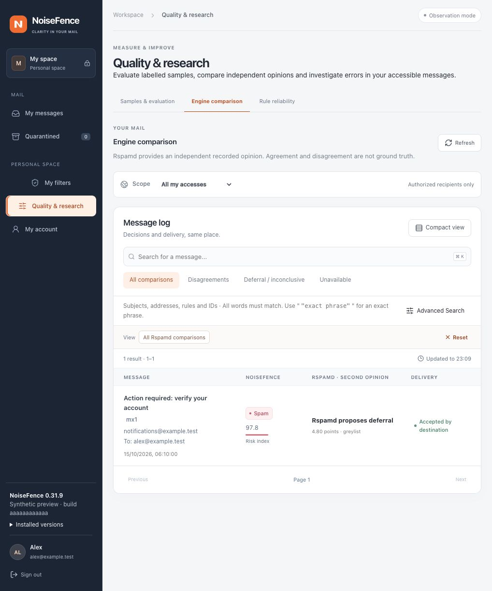

# Administration and user console

The English console uses the Rust API and a static frontend. Install the first local administrator with `user-add admin --admin`; there is no default password. Accounts protect the NoiseFence console, independently of upstream mailbox credentials.

## Console navigation

- **Messages** provides scoped search, the selected risk index, classification, analysis coverage, feedback and delivery state.
- **Message details** explains model/rule contributions and each recipient’s remote SMTP attempts. Acceptance by an upstream is not proof of inbox placement.
- **My filters** lets authorized users set mailbox/domain preferences within administrator limits.
- **My account** manages passwords, TOTP and one-time recovery codes.
- **Administration** manages domains, gateways, filters, accounts, MX nodes and operational status.
- **Quality & research → Samples & evaluation** provides frozen samples for human annotation. **Rule reliability** reports check availability and diagnostic comparisons without silently activating a model.

See [Web configuration](web-configuration.md) for the complete control map. Global filtering, domain profiles and recipient exceptions are separate scopes. Changes are drafted, reviewed and explicitly applied to future mail.

## Automatic correspondent memory

In **Filters → Identity protection**, administrators can enable local learning,
choose the memory window and recurrence requirements, or start a new observation
window. Review and activate the configuration on every MX. Message details show
recurrence, missing coverage and changed patterns, separately from the verdict.
See [learning and privacy limits](contact-learning.md).

## Identity protection workspace

Administrators manage **Filters → Identity protection** in the same reviewed
configuration workflow as other filters. The directory workspace has a source
list and focused tabs for people, groups, source scope/freshness and explicit
sending delegation. Search and paginated lists keep larger directories readable.
CSV merges by stable ID; the change preview exposes removals and protected
identities before anything is added to the policy draft.

The screen distinguishes installed data, local source edits, prepared artifacts
and the pending configuration. Preparation alone never activates a change. Global
**Review and apply** and the MX activation panel remain authoritative. Domain-based
protected-name checks live in their own expandable section and retain their
separate CSV format. Entra, Google Workspace and Okta support reviewed one-shot collection. Optional expiring schedules reuse encrypted access; SSO and a reciprocal contact graph remain separate work.

In message details, **Additional engine details → Complementary protection →
Identity observations** groups name/domain findings and explains why domain
authentication is different from person identity. No finding is not a passed
identity check. See the [identity protection guide](identity-protection.md) for
limits, CSV format, privacy and the remaining source-management work.

Development builds can also display a **Directory identity** card when a
recipient-scoped report was recorded. It distinguishes source freshness, domain
authentication, ambiguous matches and the exact directory snapshot. Missing
contact-history or sensitive-request analysis stays explicit. This observation
does not replace the saved verdict and is not backfilled onto historical mail.

Entra, Google Workspace and Okta sources can be collected once through **Directory synchronization**
in the same workspace. One-time access is the default. Optional
[encrypted saved access](directory-credential-storage.md) has explicit expiry,
replacement and revocation. A separate **Set up automatic collection** authorization permits background reads until a chosen expiry; each candidate still needs review.
A durable receipt separates collection from reviewed activation; failures and
unknown outcomes preserve the installed directory. See the [Entra](identity-entra.md), [Google Workspace](identity-google.md) and [Okta](identity-okta.md) guides
for permissions, limits and the remaining provider boundaries.

## Quality & research

One navigation entry contains three keyboard-accessible tabs:

| Tab | Purpose | Direct link |
| --- | --- | --- |
| Samples & evaluation | Annotate frozen samples, compare candidates and inspect qualification requirements. | `/?view=quality&tab=samples` |
| Engine comparison | Inspect the separate Rspamd opinion and scoped disagreements. | `/?view=quality&tab=comparison` |
| Rule reliability | Review errors on available labels, check coverage and rule contributions. | `/?view=quality&tab=reliability` |



*The screenshot uses synthetic messages and illustrative scores; it contains no private mail and is not an accuracy benchmark.*

Left/Right and Home/End move between tabs. Links survive sign-in, but never grant access. Existing `/?view=quality&sample=<UUID>` links continue to open the annotation sample. Switching away from the samples tab removes its identifier from the URL. Comparison resets keep the comparison scope; they do not switch silently to all mail. The message list shows the NoiseFence category/index and the Rspamd action/points side by side. Their units remain separate; a Rspamd deferral is not a spam verdict.

Annotation samples appear first. Create another sample or inspect **Data readiness and release qualification** in the expandable panels below. Risk (wanted/unwanted) is separate from mail type. Wanted marketing belongs to the wanted denominator when measuring false positives. Rspamd agreement, software tests and successful deployment are not evidence of calibrated filtering quality.

<a id="parcours"></a>
## Everyday workflow

Choose an authorized domain or all accessible messages, then search subjects, sender/recipient addresses, rule identifiers or queue IDs. Filter by classification, partial analysis, score, delivery state, date or MX node. Score searches use the same risk value shown in the list. Bodies and attachments are not indexed. See [message search](message-search.md).

Use **Tab** to move through search controls and **Enter** to apply advanced criteria. Opening a message focuses its title. **Back to messages** (or **Back to comparison**) returns focus to the same visible message, with search as a fallback if it is no longer listed. If an unsaved correction prompts for confirmation, **Escape** retains the draft and restores the back button; confirming the discard preserves the current result page.

Open a message to inspect its NoiseFence verdict independently from the risk index and analysis coverage. A high index can coexist with Ham when a recorded safeguard or recipient policy takes precedence; the verdict banner explains that basis. The index is not a spam probability. Historical projections are identified separately from decisions saved at receipt.

The message view separates five questions:

- **NoiseFence verdict:** the recorded category and its basis, including recipient overrides or contextual safeguards.
- **Risk index:** the recorded numeric result. An unavailable score stays blank; it never becomes an invented zero.
- **Analysis coverage:** which checks completed or were limited. A completed check does not establish safety.
- **Action at receipt:** the effective policy action, such as delivery in observation mode. This is distinct from the current delivery state.

- **Last recorded delivery:** the latest available state for authorized recipients. “Accepted by destination” means SMTP acceptance, not inbox placement. Per-recipient status, quarantine commands and remote SMTP replies remain available below.

Under **Filters & evidence**, expand a family in **Checks at a glance** to inspect each detector's state, result and role. **Signals & explanations** supports search by signal name, identifier, evidence or recorded family. Use **Raises index**, **Lowers index** or **Context & exclusions** to narrow the list. Retained weights come from the recorded calculation; without that ledger, weights are explicitly proposed. They are not percentage points, do not sum to 100, and model summaries must not be added again.

Expand the accounting, authentication or SMTP sections for technical details. If diagnostics fail to load, the page retains available signals and offers a retry without claiming the missing checks passed. Rspamd remains a separate comparison and never determines the NoiseFence verdict or action.

Use **Correct classification** for verified mistakes. The form shows the saved correction separately from your unsaved choice. Choose **Ham** for wanted mail, **Pub** for wanted marketing or **Spam** for unwanted/fraudulent mail, then select **Save correction**. Choosing an option alone does not write anything. If unsure, leave it unlabelled. A failed save keeps the draft and displays the error.

**Correction detail** controls the scope of that save:

- **General correction** updates your feedback and removes earlier detailed learning labels for this message.
- **Add a domain learning label** updates feedback and the authorized domain label in one transaction. Spam can be refined to phishing or scam. Other detailed labels for that message are replaced; the form explains this before saving.
- **Withdraw a domain learning label** removes only the selected detail. The general correction stays recorded.

These actions never rewrite the saved verdict, change an already delivered message, release quarantine or create evaluation annotations. The Bayes and neural opinions remain read-only. A failed domain-label read leaves general feedback available with an explicit replacement warning; domain-specific writes require a successful authorized-domain read.

The same form layout is used for individual and bulk sample annotations, with their purpose visible: development, regression or independent holdout. Protected evaluation messages and related campaigns remain excluded from training and sender trust. Saving one annotation retains drafts on other messages; filtering the current page also preserves those drafts. A failed refresh preserves the last loaded data and drafts, disables further saves and offers **Retry annotations**. Leaving an unfinished correction or sample asks for confirmation. Browser reload/close uses the browser’s native unsaved-change warning.

Quarantine actions apply to one authorized delivery at a time and require a concrete confirmation. Use the [actions guide](actions.md) before releasing or discarding mail.

## Review personal filter settings

**My filters** shows the installed ordering mode and offers a read-only comparison before saving. Select an authorized mailbox or domain; for a domain, also enter one original recipient accepted by its routing policy. Aliases and more-specific recipient settings can produce different results within the same domain.

Use **Review my changes** to compare installed and proposed content thresholds, effective profile sources, requested Spam/Pub actions, retention, corroboration, applicable rule order and traffic limits. The Rust preview shares profile and rule ordering with SMTP. It does not read message content, query providers, test destination inboxes or change any configuration. Conditions are not evaluated, so these mappings are not final message decisions. In observation mode, filtering tags and quarantine remain inactive; separate traffic and protocol controls still apply.

Only **Apply reviewed preferences** saves the draft. A change to the draft, chosen recipient or configuration revision invalidates the review. The server checks grants, allowed actions, threshold bounds, CSRF and the revision again at save time. Follow the activation panel until the change is installed; administrators can inspect configuration revisions and audit history. Already accepted messages keep their receipt-time settings.

**Review inherited settings** previews removal of the selected personal override before applying it. When customization is disabled, saved preferences remain dormant. Leaving an unsaved draft asks for confirmation; failed saves retain it. If a save succeeds but refreshing installed settings fails, the console distinguishes those outcomes and blocks more edits until reload succeeds.

<a id="ajouter-un-domaine"></a>
## Add a domain

1. Select **Domains → Add domain** to open the four-step setup. Enter the domain, choose an existing gateway or create one with explicit upstream hosts and a port, then choose the recipient policy.
2. The default **Use destination mailboxes** policy verifies recipients before SMTP acceptance. Unknown mailboxes receive `550 5.1.1`; unavailable checks defer with `451`. No unknown-recipient fallback is configured. Alternatively, use an explicit list of addresses and keep it aligned with the provider. See [recipient verification](recipient-fallback.md#refuse-nonexistent-recipients-before-acceptance).
3. **Validate draft** checks the entire proposed configuration against installed constraints without applying it. **Check MX records** performs a five-second public MX lookup from this console host. **Check recipient without sending mail** connects to the explicit destination with verified TLS, an empty envelope sender and one recipient, with an eight-second deadline. It never sends DATA and does not enqueue a message. A successful RCPT TO is not an inbox-delivery guarantee. A temporary refusal, network failure, invalid certificate or rejected test envelope is unavailable, not evidence that a mailbox is missing.
4. **Add to draft for review** returns to the existing revision-controlled save process. Changes remain unsaved until explicitly applied. Wait for activation on every MX. Results are tied to the checked draft and revision; changing either invalidates them. Editing the test recipient invalidates its SMTP result while preserving unchanged DNS/configuration checks.
5. Before changing public DNS, send an authorized test message through **each MX** and confirm delivery and mailbox placement at the provider. Inspect NoiseFence delivery details and the received message headers. The console check cannot prove another MX's connectivity, acceptance after DATA, Proton forwarding behavior or DNS propagation. Verify the host's TLS certificate, PTR, MTA-STS and TLS-RPT separately. A console domain does not create an upstream mailbox or publish DNS records.

The advanced domain card remains available for aliases, cache TTLs, disabling reception and routing changes. Settings for existing domains and filtering engines are preserved by setup. The API requires administrator access, CSRF, an enabled domain in a valid complete draft and the current configuration revision. Network checks allow one operation per process, reuse the relay's public-address restrictions and never follow public MX records for recipient probes.

Invite users with a one-time expiring link. They choose their own password; no invitation email is sent automatically. Revocation invalidates unused links. Administrator invitations grant organization-wide configuration and message access.

<a id="autorisations-et-confidentialité"></a>
## Permissions and privacy

Administrators can see all organization messages. Users see only granted recipients/domains; alias destinations and Bcc permissions are checked server-side. Shared mailbox preferences belong to the mailbox, not the editor’s account. Every mutation rechecks active sessions and current grants.

Passwords use Argon2id. Production sessions use secure cookies, origin validation and CSRF protection. Account disablement, password changes and relevant access changes revoke sessions. Provider credentials are stored privately and never returned in exports, history or subsequent API reads. Historic explanations and user-defined labels remain recorded data in their original language; software-generated labels and new explanations are English.

<a id="persistance-application-et-restauration"></a>
## Revisions and recovery

Local SQLite deployments store configuration revisions, accounts and history in WAL mode. Installations using the [PostgreSQL management backend](../deploy/postgresql/README.md) store shared console data there; each MX still keeps its durable message queue locally. Concurrent edits use a revision check; a stale draft cannot overwrite a newer change. Use **Server status → Configuration history & audit** to compare the last 100 retained revisions without changing the draft, search the latest 200 audit events and restore a reviewed configuration as a new revision. Recorded revisions and staged activation proposals remain separate; check the activation panel for installation. See the [complete review and recovery workflow](web-configuration.md#save-review-and-apply). Existing transactions and accepted deliveries retain their captured policy and route.

If a saved policy prevents startup, first back up the current state. On a coordinator or standalone host, stop the service and restore the bootstrap TOML policy without removing accounts, queue or history:

```sh
sudo systemctl stop noisefence
sudo -u noisefence /opt/noisefence/noisefence --config /etc/noisefence/config.toml console-reset
sudo systemctl start noisefence
```

This is a policy reset, not a password reset or database rollback. A worker refuses local console reset. Paired installations must preserve HA configuration and follow the [recovery guide](high-availability.md).

<a id="validation-automatisée"></a>
## Verification

Console tests cover administrator/domain/mailbox grants, aliases and Bcc, statistics, search, CSRF, account revocation, revision conflicts, durable settings, secret protection, quarantine and routing changes during SMTP transactions. Read queries are bounded and isolated from durable queue writes. The configured backend supplies the console data; neither a slow report nor an unavailable central database should extend an already captured SMTP transaction with an unbounded query. Frontend tests, type checks, lint and static builds run in CI.

## Synthetic local demo

From a source checkout, use the Node.js version required by `web/package.json`:

```sh
cd web
npm ci
npm run dev -- --host 127.0.0.1 --port 3011
```

Open `http://127.0.0.1:3011/demo.html?case=ham&role=user` for a synthetic user account, or omit `role=user` for the administrator layout. Other message cases are `spam`, `pub`, `quarantine`, `encrypted` and `error`. Use `open=list` to start in the message log. Add `view=quality&tab=comparison` or `view=quality&tab=reliability` for the research tabs. The example sample ID is `00000000-0000-4000-8000-000000000002`.

The demo intercepts every API request. Message corrections, individual/bulk annotations, quarantine commands and explicitly enabled administration scenarios only change browser-memory fixtures; reloading resets them. Other writes are refused and unsupported API views display an explicit fixture error. No mailbox, provider key or running Rust service is required. This is a UI demonstration, not a filtering benchmark or an authentication test. The production Vite build includes only the normal console entry, not `demo.html` or its fixtures. Do not expose the development server publicly.

For administrator configuration tests, add `administration=local` and open **Server status**. Preview revision 24, load it as a draft, navigate to **Filters**, then review/apply. Optional scenarios are `refresh-failure` (acknowledged save followed by one failed read), `conflict` (concurrent revision), `staged` (pending MX activation), `operations-failure`, `audit-failure`, `revisions-failure` and `history-missing`. These scenarios never change a real policy. History and comparison data are synthetic; no credentials are included.

For `case=quarantine`, add `quarantine=expired`, `unavailable` (one failed history read), `remote` (queued command), `unconfirmed` (expired request without a receipt) or `late` (late confirmation with an older delivery snapshot). The default case permits local release/discard in memory. Reloading restores the held fixture.

Correction scenarios accept `correction=failure` (one failed save), `labels=unavailable` (domain-label read failure), `annotations=refresh-failure` (one failed refresh after a saved annotation) and `purpose=holdout` (protected-sample presentation). All use synthetic data and make no production writes.

The synthetic demo also includes **Domains → Add domain**. Its validation, DNS and SMTP results are simulated in the browser: no lookup, SMTP connection or policy save occurs. Use `mail@new.example.test`, `missing@new.example.test` or `busy@new.example.test` to inspect the three recipient outcomes. Real SMTP behavior is covered separately by isolated Rust integration tests.

## Provider operations

Open **Filters → Providers & budgets** for the configuration loaded on the console host, the active revision and a capture timestamp. The overview keeps unapplied drafts separate and links to the existing keys, quotas, LLM, RBL and comparison editors. It does not probe external providers, send message content, renew pricing verification or enable an engine.

CRDF and VirusTotal distinguish saved credentials from credentials captured by the loaded configuration. A captured key does not certify upstream permissions or licensing. Limits use the effective Web configuration, not bootstrap values. Missing counters are unavailable rather than zero. Cooldown still applies with unlimited quotas.

Request counters and LLM accounting belong to the responding node. A coordinator also reserves credits issued to other MXs: summing coordinator and worker counters double-counts those credits. LLM amounts include outstanding reservations and conservative charges, not provider invoices. Worker credit ceilings can be lower than the configured monthly ceiling. A missing ledger is shown as not started; an unreadable ledger is unknown. Reading this view never initializes or migrates that ledger.

Recorded checks use accessible history from the last 24 hours, potentially across MXs. Select the current engine build or all builds explicitly. Historical failures are not a live health probe or evidence of spam. CRDF/VirusTotal p95 uses recorded elapsed times only when detailed timing metadata exists, including failed attempts and cache lookups. Phase totals may overlap and are never treated as percentiles. No observations means no availability or latency conclusion. Rspamd remains an independent comparison; Scaleway suspension and all activation controls remain unchanged.

### Identity editor preview

For a disposable browser-memory fixture, run `npm run dev -- --port 3013` in
`web/` and open
`http://127.0.0.1:3013/demo.html?administration=identity`. Select **Filters → Identity
protection**. The three initial names are synthetic. Review/apply changes only
this browser-memory fixture; refresh resets it. Select **Organization directory**
to inspect its people. Use `&directory=empty` for onboarding or
`&directory=unavailable` to exercise a source-status failure. Add `&identity=1` to render a
synthetic identity observation in the initial message details. No mail is sent,
no directory is contacted and these fixtures are excluded from the production
build. Use `&providers=unavailable` to exercise the status failure and retry path.
