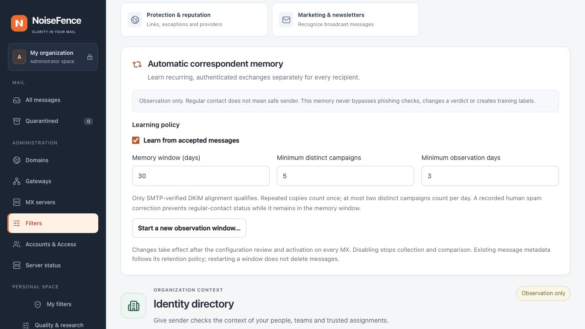
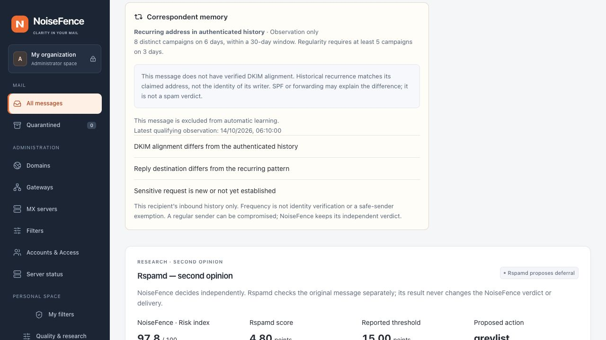
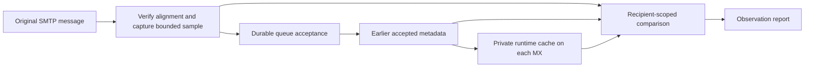

# Automatic correspondent memory

NoiseFence can learn recurring inbound exchanges without asking for a label on
every message. It compares the next message with earlier accepted messages from
that exact sender to that exact envelope recipient. It highlights changes in a
recurring display name, Reply-To destination, link domain or sensitive request.

Memory itself never reduces a score, creates a HAM/PUB/SPAM label, releases a
quarantine, exempts a sender from scanning or trains a model. The separate
[identity contribution policy](identity-correlation.md) defaults to observation.
Administrators can explicitly enable a bounded contribution for corroborated
changes after validation. Recurrence describes traffic, not consent or the writer's identity.
A compromised account can still authenticate successfully. Rspamd and LLM opinions
are not learning labels. Human-labelled quality datasets remain separate.

## Configure in the Web console

Open **Administration → Filters → Identity protection → Automatic correspondent
memory**. No directory or SSO connection is required.

1. Have the installation administrator [install the same private memory key](contact-memory-key.md)
   on the management host and every MX. Reload the console; it displays key readiness.
   Enable **Learn from accepted messages**. The draft records only the public key ID.
2. Set the memory window: **7–30 days**, default **30**.
3. Set the minimum distinct campaigns: default **5**. At most two campaigns per
   UTC day contribute, so the configured minimum cannot exceed twice the window
   length (maximum 60).
4. Set the minimum observation days: **3–14**, default **3**, within the window.
   The earliest and latest observations must also span at least `minimum_days - 1`
   full days; crossing midnight cannot manufacture maturity.
5. **Review and apply** the configuration. Follow the normal policy activation
   on every MX. Existing administrator, MFA, CSRF and revision checks apply.

This capability starts in **0.32.0-rc.4**. Upgrade every MX before applying an
identity or memory policy. A published rc.3 worker does not support these fields;
NoiseFence refuses mixed-build activation instead of silently dropping them.
Use the [coordinated maintenance procedure](paired-upgrades.md) for an enrolled
two-MX installation. An unchanged legacy policy can be retained during that
upgrade; enabling memory is a separate reviewed activation afterward.

Existing installations with no `contact_learning` setting remain disabled.
Disabling stops collection and comparison for subsequent messages. **Start a new
observation window** adds a cutoff to the draft. After activation, earlier samples
are excluded from future comparisons; it does not delete messages or corrections.
Stored metadata still follows the installation's normal retention schedule.

Equivalent server configuration for initial installation:

```toml
[contact_learning]
# Public ID printed by contact-memory-key --check, not the secret file contents.
key_id = "<64-character-installed-key-ID>"
enabled = true
retention_days = 30
minimum_campaigns = 5
minimum_days = 3
learn_since = 0
```

`learn_since` is a Unix timestamp. It must not be in the future. The shared policy
carries the settings to the workers; enabling them requires matching supported
builds. They do not change model catalog identities or select a new model.



*Local demonstration, not production. No real identities or message data are shown.*

## What qualifies

- A real SMTP session verified by NoiseFence, with complete DMARC DKIM alignment.
  SPF alone, supplied envelopes and imported Authentication-Results do not qualify.
- Exactly one valid From mailbox, unambiguous Reply-To and complete text features.
  The current parser is bounded to 2 MiB for this check. Known malware is excluded.
- A nonempty envelope sender. Locally generated bounces and verification messages
  do not create observations.
- A message durably accepted into the queue. The sample is stored with its
  recipient-specific analysis, not written by the analysis task itself. Failed
  acceptance or rendering leaves no learned message.

The campaign fingerprint is an installation-keyed HMAC of the existing normalized
content fingerprint, scoped to the sender and recipient. Dates, Message-ID and
varying numbers do not create extra campaigns. Current-campaign
copies, future timestamps and observations outside the window are excluded.
Conflicting copies do not establish a baseline. Persistent spam can become
frequent, which is precisely why frequency is not used as an allowlist.

Learning and comparison have different eligibility rules. A bounded, unambiguous
message from a real SMTP session can still be compared with the same claimed
address's authenticated history when its own DKIM alignment fails. It contributes
**no retained sample**. The message report distinguishes the recurring address,
current authentication, and exclusion from learning; an authentication change is
shown only when the current check completed and did not verify alignment. A timeout
or missing result is unavailable, not a failed alignment. SPF-only mail, forwarding
and a legitimate sender migration may explain a difference: it is not itself a
spam verdict. Ambiguous From addresses, imported headers and null-envelope bounces
still do not establish this comparison. A deadline during optional memory lookup
does not erase completed detector evidence.



*Local synthetic message report. History and current-message authentication are
separate; this capture does not demonstrate production accuracy.*

A retained, authorized user correction to spam vetoes regular-contact
status for that sender and recipient. It is not overwritten by automatic learning.
Future corrections are not used when assessing an earlier timestamp. Revoked or
disabled annotators follow the existing selected-authority eligibility rules.
Labels reserved for evaluation are excluded from this automatic feedback path;
they are never silently reused as training or trust evidence.

An indicator must recur on at least two days before it is considered established.
One unusual message cannot silently normalize a new Reply-To or link destination.
Link and request comparisons additionally require complete local protection and
native-rule observations under the same native policy digest. Missing checks are
shown as unavailable, never as a normal or safe pattern. These are narrow rule
signals, not a general understanding of all possible payment or credential demands.

## Persistence, multiple MXs and bounded work



The current message never trains its own comparison. The acceptance path, not
an analysis result or a delivery retry, creates the retained observation.

Samples live in the existing message metadata and inherit its retention and
backup controls. A restart does not reset the memory. SMTP retries and replicated
copies share campaign fingerprints. There is no separate authority or automatic
rewrite of the model files.

With selected PostgreSQL management, accepted message metadata is projected in
background into the private runtime-history cache on each MX. SMTP never queries
PostgreSQL or an identity provider for this feature. The existing authenticated
node transport carries a separate contact projection; it does not expand the
human-labelled training rows. Old clients receive the legacy snapshot shape;
new clients report contact history unavailable when an older server cannot provide
it. Runtime-history freshness remains 60 seconds. Synchronization is eventual,
so a just-accepted message need not appear immediately on another MX.

A standalone installation queries retained local message metadata. Both paths
use a single bounded lookup per SMTP transaction, a 200 ms deadline, SQLite
interrupts and at most four background lookup workers. A lookup reads at most
2,000 matching observations for the current recipients. The shared projection is
limited to 10,000 observations within the existing 64 MiB runtime snapshot budget.
Exceeding capacity reports **History capacity reached** and suppresses inference
from the truncated history. Increasing these limits requires measured performance
work; this release does not claim unlimited-volume contact learning.

A missing/stale selected cache is **unavailable**; it never falls back to obsolete
local history and never becomes evidence that a sender is new. The automatic
memory is independent of directory freshness and of the separate human-confirmed
relationship graph. A directory report may lack the latter while automatic memory
has its own valid observation.

## Privacy and interpretation

Each sender key includes the actual envelope recipient and its domain. Alias
local parts, case, dots and plus tags are preserved; histories are not merged
across recipients, aliases or domains. Recipient-specific queue variants prevent
Bcc history from leaking into another recipient's analysis. Per-message Web
reports expose only counts, timing and named changes, after normal message access
checks. They contain no other recipients, contact lists, raw join keys or samples.

New private samples use domain-separated **HMAC-SHA-256** for sender/recipient,
name, reply target, campaign and link domains, plus bounded request IDs. The key
is a random 32-byte installation secret, distinct from provider credentials and
the directory vault. Policy bundles carry only its public SHA-256 identifier.
Neither database projections nor API reports contain the secret. Identical inputs
on different installations, or for different recipients, have different tokens.
This prevents an offline address dictionary from being checked against memory
fingerprints alone. It does not anonymize the mail database, which already holds
message addressing, and does not protect a host or backup containing the key.

The key is loaded into each engine generation outside SMTP processing. A missing
or mismatched key disables capture/comparison with **Private memory key
unavailable**; the remaining mail analysis continues. A new or changed enabled
memory policy requires matching operator-installed material before activation.
The console permits disabling the feature without restoring a lost key.

Legacy `contact-learning-1` samples stay readable for historical records and
retention, but **never** establish a baseline for `contact-learning-2`. They cannot
be securely converted from hashes without the original source data. No automatic
replay of old mail is performed. New history must meet the configured day/campaign
requirements again. No new provider receives mail content or contact history.

Only inbound traffic seen by the gateway is observed. References, In-Reply-To and
quoted headers do not prove that the recipient replied or that two people know
each other. Outbound/internal mailbox connectors, reciprocal graph exploration,
scored novelty discounts and self-training model activation are outside this
implementation. Any future scoring change needs independent, time-separated
false-positive and capture evaluation; no accuracy improvement is claimed here.

For chronological, campaign-separated research, use the [offline identity evaluation](identity-evaluation.md). It keeps labels out of memory and reports known false candidates and misses without claiming full-filter accuracy.
