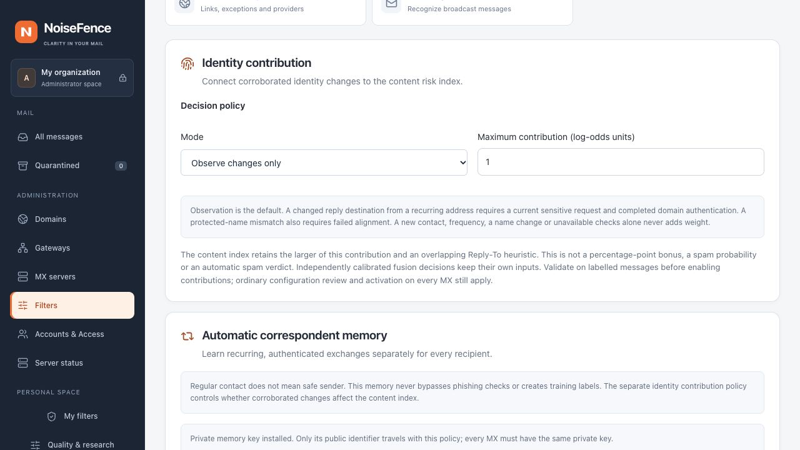

# Private correspondent-memory key

This development feature uses one installation-owned HMAC key on the management
host and all participating MXs. It is independent of TLS, directory-provider
credentials and the directory-vault encryption key. Secret provisioning remains
an installation operation; memory retention, maturity, reset and contribution
policies remain configurable in the Web console.

## Install and verify

Run the command as the service account, with its normal configuration and an
existing private `data_dir`:

```sh
sudo -u noisefence noisefence --config /etc/noisefence/config.toml contact-memory-key
sudo -u noisefence noisefence --config /etc/noisefence/config.toml contact-memory-key --check
```

The first command creates `data_dir/contact-memory/` (0700), a random 32-byte
`key` (0600) and a `key-id` marker (0600). Existing material is never replaced.
The JSON output contains only `key_id` and `activated: false`. It never prints the
secret, enables learning or changes a policy. Loading a runtime never initializes
a missing key. Files must be owned by the effective service account, regular and
single-link; symlinks, FIFOs and shared permissions are refused.

Transfer `key` through your authenticated administrator channel to an owner-private
staging file on each other MX. Do not use Git, chat, command arguments containing
the bytes, public assets or the Web configuration JSON. Install from that file:

```sh
sudo -u noisefence noisefence --config /etc/noisefence/config.toml contact-memory-key --from-file /private/staging/contact-memory-key
```

Verify the printed ID is exactly the same on each participant, then remove the
private staging copy according to your installation procedure. The command does
not perform any network transfer. Reload **Administration → Filters → Identity
protection**; enabling memory records the installed public ID in the reviewed
policy. Coordinated activation checks the local key for a changed enabled memory
policy on every participant. Keys are not distributed in the policy bundle or the
runtime-history snapshot. No SMTP lookup contacts a key service.

## Failure and recovery

Include **both** `contact-memory/key` and `contact-memory/key-id` in private,
encrypted installation backups. A database dump or a downloaded policy bundle
alone is insufficient. The hardening metadata and full backup exporters now include
these two files and verify the marker against the actual key and installed policy.
Offline restore verification refuses missing or mismatched material. Upgrade the
hardening helpers together, including `identity_recovery.py`. Console standby
checkpoints do not provision installation secrets; retain a protected key copy for
that recovery path too. Keep a separately access-controlled copy of the key; a
backup containing both memory records and the key no longer protects those
records against dictionary guessing.

When a key is lost, an existing `key-id` marker prevents generating a replacement.
Restore the exact matching key using `--from-file`; a foreign key is rejected
without replacing either file. A conflicting installed key is also never
replaced. `--check` performs no writes. Missing or invalid material yields a
nonzero exit status, without printing secret bytes.

An already installed policy remains loadable after key loss. The mail engine
continues; correspondent memory is unavailable and stores no new sample. Reload
the engine generation through the normal configuration workflow after restoring
the key. A resident generation pins its original in-memory key until reloaded;
deleting a file is not a mechanism for revoking a running generation. Use the Web
collection switch to disable memory.

A different key is a different history epoch. This implementation deliberately
has no automatic key rotation or conversion of legacy unkeyed hashes. Coordinated
rotation requires a separately reviewed migration; never erase the identity marker
to hide a mismatch. Restoring a policy does not restore a key.

## Qualification

Synthetic tests cover distinct installations/recipients, restart, exact-key
restore, wrong-key refusal, private permissions, link/FIFO rejection, missing-key
mail-service continuity, legacy-sample exclusion and shared-policy consistency.
They do not demonstrate production capture rate or false-positive rate. Read
[correspondent memory](contact-learning.md) for learning eligibility and limits.



*Unedited local UI demonstration. Key readiness is synthetic, not a production activation.*
