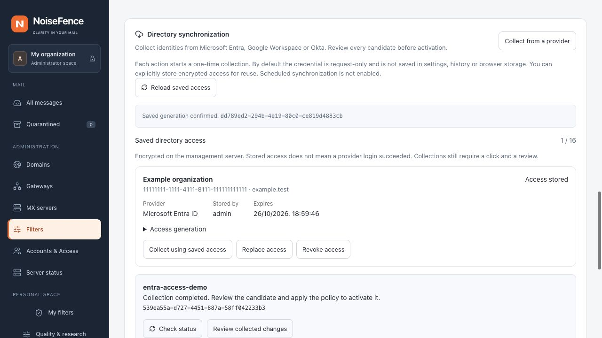

# Directory credential storage

Development builds support **optional encrypted access** for Entra, Google
Workspace and Okta under **Filters → Identity protection → Directory
synchronization**. No provider is connected by installation. Automatic correspondent
memory works without any directory credential; see [contact learning](contact-learning.md).

## Save, collect, replace and revoke

The provider form defaults to one-time, request-only access. To retain it, select
**Store encrypted access for reuse**, choose a lifetime and confirm **Review
encrypted access**. This creates a connection only; it does not contact the provider,
schedule collection, import identities or activate a policy.

The **Saved directory access** panel lists scope, owner, expiry and state. **Access
stored** confirms local persistence, not successful provider authentication. Use
**Collect using saved access**, inspect its durable receipt, review the candidate,
then apply the normal policy revision. Existing installed directory sources remain
unchanged after a collection failure, revocation or expiry.

**Replace access** creates a new credential generation for the same immutable
source. It requires the current generation; another administrator's replacement
cannot be overwritten silently. **Revoke access** clears the current encrypted
payload. Active collection checks authorization every two seconds while waiting
for the provider and again inside the transaction that commits a ready receipt.
Revocation, rotation, expiry or loss of administrator authorization refuses that
result. Already transmitted provider requests cannot be recalled. Revocation does
not remove an already prepared or installed directory, and does not revoke the
secret at the provider.

Before submitting a save, the browser retains only an operation UUID in session
storage. If the response is lost, use **Reload saved access** and compare that UUID
with the recorded generation. No credential is stored in browser storage or returned
to the page, and no secret-bearing request is automatically retried. A restarted
server retains connections and receipts, but does not resume an interrupted job.

Scheduled collection, OAuth refresh and automatic snapshot activation are not
implemented. Saving a credential is not permission to reuse an administrator's
browser session indefinitely.

Credentials are unrelated to SMTP authentication, mailbox routing, console login
or recipient permissions. Directory records do not grant any of those rights.
Stored connections are management-only: they are not part of policy bundles,
message metadata, worker credential manifests or the
SMTP path. A public status view contains metadata and state, never ciphertext or
a plaintext credential. A synchronization receipt can contain the source ID and
credential generation, never its encrypted payload.

*Unedited local demonstration with synthetic connection metadata and provider
responses. This is not a connected tenant or a production credential.*

## Encryption and key handling

Each installation uses a random 256-bit key at
`<data_dir>/directory-vault/key`. The parent directory must be private (`0700`)
and the key must be an owner-private, single-link, regular 32-byte file (`0600`).
The loader rejects symlinks, group/other access and malformed files. Initialization
publishes a fully written and synced key without overwriting an existing key.

Each record uses AES-256-GCM with a fresh random 96-bit nonce. Authenticated
metadata binds the ciphertext to all of the following:

- source identity, provider, tenant, scopes and freshness configuration;
- selected storage authority, encryption key ID and generation;
- previous generation, authorizing administrator and account version;
- creation time and expiry.

Changing those values without re-encryption makes decryption fail. Encryption
protects a database copy without the installation key. It does not protect against
a compromised running management process or an attacker with both the database
and key. Credentials are temporarily present in process memory; guaranteed memory
zeroization is not claimed.

Loading never creates a key. The authorized initialization path checks the selected
repository under its mutation lock. If any connection record exists, a missing key
requires restoration; it is never silently replaced. A malformed or inaccessible
key is also not replaced. The key is not recreated automatically after revoking
all connections.

## Repository and authorization

SQLite and selected PostgreSQL implement the same generation checks. PostgreSQL
unavailability fails the operation; it never falls back to a stale SQLite record.
The repository rechecks the administrator session and MFA for each administrative
operation. A saved credential also records its owner's account version. Disabling
that account, removing administrator rights or changing its version prevents reuse
of the saved connection. These checks are not a reusable scheduler grant: a future
background worker will need its own explicitly configured, revocable authorization.

At most 16 source connections can be stored. A rotation must reference the current
generation and preserve the source configuration. Competing rotations cannot both
win. Repeating the identical committed record is idempotent; a different record
cannot reuse the current generation. A stale revoke cannot revoke a later rotation.
Revocation removes the current encrypted payload and retains a tombstone so that a
retry cannot restore the revoked generation. It does not erase old database backups
or prove that a provider has revoked the underlying secret. Provider-side revocation
remains necessary when a secret is compromised.

Repository states are `configured`, `expired`, `revoked`, `authorization_changed`
and `not_yet_valid`. The Web API also reports `key_unavailable` or
`configuration_changed` when the local key or installed source no longer matches,
and `directory_unavailable` when the installed catalog cannot be read. `configured` means locally usable material, not a successful provider
login or a synchronized directory. The collector rechecks the current generation and authorization before provider
use and before committing its result. A previously returned record is not an
enduring grant.

The maximum stored lifetime is 90 days for an Entra application secret and one hour
for a Google or Okta access token. An earlier provider expiry still applies. Refresh
tokens, service-account keys, managed identities and renewable Google/Okta workload
authorization are not implemented here. Expiry does not refresh or extend itself.

## Migration, backup and restore

The optional connection component has its own version and SQL checksum. It does not
rewrite the immutable central v1 schema or change the SMTP queue format. An unknown
component version or changed checksum fails closed. Central setup creates the
component through `Central::migrate`; local setup uses an authorized transaction.
Do not hand-edit the registry to bypass a migration error.
Offline SQLite-to-PostgreSQL account import refuses existing directory connection
records, including revocation tombstones, until an explicit credential migration
is implemented. It never silently discards them. A destination with any connection
rows is not treated as empty.

Installation and recovery procedures must retain **both** the management database and the original vault key
in protected backups. Copying ciphertext to another authority or losing the key
makes it unusable. Restoring an old database may restore an earlier credential state;
reconcile provider revocations and authorizations before using a restored connection.
Do not distribute the key to SMTP workers to make such a restore appear successful.
Before enabling saved access on a real management server:

1. Include `directory-vault/` in the private installation backup along with the
   selected management database. Keep the key out of public artifacts, Git,
   SMTP policy bundles and browser downloads. Protect the backup independently.
2. Test restoration on an isolated copy with the same authority binding and no
   provider egress. Restore the original key as the service account, directory
   mode `0700`, file mode `0600`, with no symlinks or hard links.
3. Check the saved generations, owners, expiry and revocations. A readable key
   alone does not establish usable access. Do not use an older database to undo
   a revocation or to replace current production state.
4. If the key is lost or malformed, stop using saved access. The UI shows
   **Encryption key unavailable**; existing mail filtering and last-good snapshots
   remain independent. Restore the original key from a protected backup. There is
   no reset-key button or automatic re-encryption migration in this increment.

Production backup qualification and a dedicated key-recovery CLI remain rollout
work. The feature has only been exercised with disposable keys and synthetic data.

## Administrative API

All paths below are under `/api/v1`. Role, current session and MFA are checked on
every request; mutations also require Origin/CSRF validation. Credential requests
are bounded to 64 KiB and ten seconds before deserialization. Errors omit provider
response bodies, credentials and ciphertext.

| Method and path | Purpose |
| --- | --- |
| `GET /admin/identity/connections` | Metadata-only status, current revision/catalog and vault availability |
| `POST /admin/identity/connections` | Explicit save or replacement |
| `POST /admin/identity/connections/revoke` | Revoke the exact source/generation |
| `POST /admin/identity/sync/stored` | Start a bounded one-time collection using the exact saved generation |

Save fields: `operation` (UUID), `revision`, `catalog_sha256`, `expected_generation`
(null for a new source), `source`, Unix-seconds `expires`, and a typed `credential`.
Credential kinds are `entra_application` (`client_id`, `client_secret`),
`google_access_token` or `okta_access_token` (`access_token`). Do not place secrets
in URLs, shell history or shared request examples. Scope must match configured
receiving domains; an installed source must match exactly.

Revoke accepts `{source_id, generation}`. Stored collection accepts `operation`,
`revision`, `catalog_sha256` and `connection: {source_id, generation}`; it returns
HTTP 202 with the ordinary synchronization receipt. Use
`GET /admin/identity/sync/{id}` to read the result. No endpoint returns a credential
or activates a collected snapshot. Workers refuse these management operations.

## Validation

Synthetic tests cover encryption randomness and metadata tampering; expiry and
provider binding; key permissions, links and missing-key behavior; SQLite restart,
MFA, authorization changes and competing rotations; real disposable PostgreSQL
persistence, selected-authority dispatch and component migration; authenticated
API limits and lost-response reads; cancellation during collection and transactional
revocation checks before ready receipts. Web checks cover expiry, unavailable
states, escaped metadata and the separate collection/review flow.
These tests do not establish live provider connectivity or email detection accuracy.
