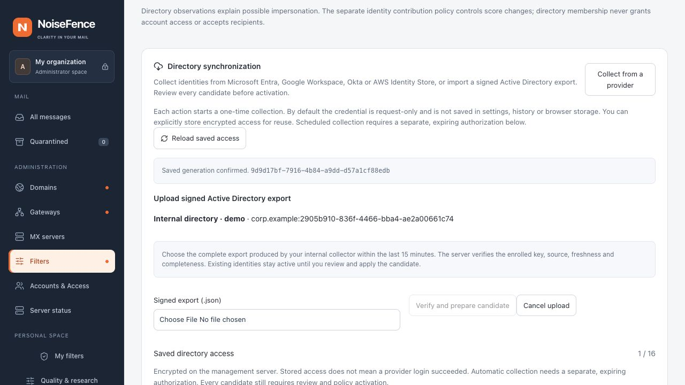

# Active Directory: signed internal collection

This development feature builds a reviewed NoiseFence identity-directory candidate from an **internal Windows collector**. The Linux MXs do not connect to LDAP. It does not change recipient routing, grant console access, synchronize passwords or infer mailbox delegation. It supplements [recurring correspondent memory](contact-learning.md); familiarity alone never proves a sender is safe.

The Rust engine verifies the export. The optional Windows helper in [`tools/ad-collector`](../tools/ad-collector/NoiseFence.AdCollector.csproj) uses .NET 10 and `System.DirectoryServices.Protocols`. It connects to one explicitly selected domain controller using **LDAPS on port 636 and Kerberos** under the current Windows identity. There is no NTLM fallback, Basic authentication, referral chasing, certificate-validation bypass or arbitrary LDAP filter. Use a domain-joined collection host with correctly configured DNS, clock synchronization and a valid domain-controller certificate trusted by Windows.

## Prepare the internal collection host

1. Use a dedicated Windows service identity with read access to the entire intended domain's users, groups, memberships and required attributes. Do not grant domain administrator rights. Confirm the intended scope with the AD administrator: LDAP ACLs can hide objects or values without returning an error, so a successful scan is **not proof of complete administrative visibility**.
2. Build the helper from reviewed source with a supported .NET 10 SDK:

   ```powershell
   dotnet restore tools/ad-collector --locked-mode
   dotnet build tools/ad-collector --no-restore -c Release
   dotnet run --project tools/ad-collector --no-build -c Release -- self-test
   ```

   The lock file pins the NuGet dependency; audit warnings fail the build. Offline fixtures do not contact LDAP. The helper is distributed as source in this development change, not as a signed Windows installer. Build and deploy it through your organization's Windows software process.
3. Provision a non-exportable **ECDSA P-256** signing certificate in `LocalMachine\My`. For example, in an elevated PowerShell session:

   ```powershell
   $collectorCertificate = New-SelfSignedCertificate `
     -Type Custom -Subject 'CN=NoiseFence AD collector' `
     -CertStoreLocation 'Cert:\LocalMachine\My' `
     -KeyAlgorithm ECDSA_nistP256 -KeyExportPolicy NonExportable `
     -KeyUsage DigitalSignature -NotAfter (Get-Date).AddDays(90)
   $collectorCertificate.Thumbprint
   ```

   Grant only the collection service identity access to this private key using your Windows certificate-management tooling. The signing certificate is pinned by public key in NoiseFence; it is **separate from the LDAPS server certificate**, which still requires normal trust and hostname validation. Keep the private key on Windows; never paste a PFX or private key into NoiseFence.
4. Create an operator-owned directory with ACLs restricted to the service identity and administrators for the profile and exports. Exports contain personal directory metadata and are signed, **not encrypted**. Do not use a shared Downloads, public web or general-purpose network folder.
5. Record the DNS domain, domain object's immutable `objectGUID`, and the intended controller's FQDN. Create this profile inside the restricted directory:

   ```json
   {
     "source_id": "internal-ad",
     "domain_dns": "corp.example",
     "domain_guid": "2905b910-836f-4466-bba4-ae2a00661c74",
     "controller": "dc1.corp.example",
     "certificate_thumbprint": "REPLACE_WITH_THE_40_HEX_CHARACTER_THUMBPRINT"
   }
   ```

   Domain and controller names must be lowercase FQDNs; the non-nil domain GUID must be canonical lowercase. The collector verifies RootDSE's controller name and default naming context, then the domain GUID. The receiving email domain can differ from the AD DNS domain.

## Enroll the verification key in NoiseFence

On the internal host, run:

```powershell
dotnet run --project tools/ad-collector --no-build -c Release -- public-key CERTIFICATE_THUMBPRINT
```

In **Filters → Identity protection → Directory synchronization**, select **Active Directory — internal collector**. Set the same stable source ID, an operator label, the authority `corp.example:2905b910-836f-4466-bba4-ae2a00661c74`, and explicitly authorized receiving domains. Paste only `public_key` from the command output. Compare the SHA-256 fingerprint in the enrollment dialog with `key_id` on the internal host.

Enrollment has an explicit expiry of at most 90 days. Choose an earlier date if the certificate or operational authorization expires sooner. It uses the [management connection vault](directory-credential-storage.md), with source, owner authorization version and generation binding; the private signing key is never stored there. Rotation uses **Replace verification key** and requires a new explicit fingerprint review. Revocation or rotation invalidates pending jobs using the old generation. Neither operation retroactively deletes an installed directory; remove/review the source separately if that directory must no longer be used.

## Collect, upload and review

```powershell
dotnet run --project tools/ad-collector --no-build -c Release -- collect C:\NoiseFenceAD\profile.json C:\NoiseFenceAD\export-20261025.json
```

The output path must not already exist. A failed collection produces no usable partial export. Import a successful export **within 15 minutes** through **Upload signed AD export** on its saved connection. The browser sends it through the authenticated administrator API. Update an existing reverse-proxy installation using the exact import-route limits in `deploy/nginx.conf` or `deploy/Caddyfile`: 24 MiB for AD envelopes and 17 MiB for manual imports. Other console routes keep their smaller limit; the Rust handlers enforce their own tighter bounds after authorization. It stores only the job UUID for recovery, never the export or key in browser storage.

The server verifies the previously enrolled public key, signature, source/domain binding, signed job UUID, timestamps, object counts and graph consistency. Review the candidate and activate it through the existing policy process. Large deletions, missing protected objects, stale revisions and replication checks retain their existing protections. The collection timestamp is preserved rather than rewritten at upload. A failed upload, missing membership or expired key leaves the installed directory unchanged.

If an HTTP response is lost, inspect the same job receipt before another attempt. Replaying its UUID is refused by the durable journal; changing the outer UUID invalidates its match to the signed payload. Accepted jobs use the existing authorization checks during collection, preparation and durable completion. Public-key enrollment cannot authorize a remote pull or a collection schedule. Periodic execution may be managed internally, but **each signed export still needs an administrator upload and candidate review** in this version.



*Unedited local demo with synthetic directory metadata; no live AD server, private key or personal identity was used.*

## Mapping and boundaries

- Users and groups use canonical immutable `objectGUID`, never display names or addresses as identifiers. `displayName` falls back to explicit given/family names, then `cn`.
- Only `mail` and `SMTP:`/`smtp:` proxy addresses become aliases. UPN, SAM account names, login names and X.500 proxies are not mail aliases. SMTP local-part case is preserved by the shared NoiseFence mailbox parser.
- User activity follows the `ACCOUNTDISABLE` bit in `userAccountControl`; an absent value is unknown. Groups represent existing directory objects. Neither an active account nor an authenticated email proves benign intent.
- Direct user/group edges and users' primary-group membership are collected. Nested edges remain explicit. Cycles, duplicate identities and dangling user/group references fail the candidate. Computer and foreign-security-principal memberships are explicitly counted as exclusions; unknown types fail the candidate. Cross-domain referrals are not followed.
- No executive role, protected-group setting, shared-mailbox classification or send-as delegation is inferred from AD groups. Existing local protection assignments must survive the reviewed import; missing protected IDs require explicit resolution.
- LDAP paging and `member;range` traversal are bounded and checked. A changed group's `uSNChanged` during range retrieval aborts the export. This is a full paged collection, **not an atomic AD transaction** or a DirSync/delta client: concurrent edits can require retry and review. The collector cannot discover records its service identity is not permitted to read.
- Limits: 300 seconds, 10 seconds per request, 4,096 requests, 64 MiB of observed directory attribute values, 20,000 users, 5,000 groups, 100,000 membership edges, 128 raw proxies and 32 normalized mail aliases per identity, 16 MiB of signed payload. Paging uses 100 objects. Signature validation and normalization run off the async SMTP path.
- Envelopes contain `noisefence-ad-export-1`, a canonical job UUID, SHA-256 key ID, base64 payload and base64 64-byte IEEE P1363 ECDSA signature. The signed bytes are the UTF-8 domain separator `noisefence:ad-export-1` followed by a zero byte and the exact payload bytes. JSON is not reserialized for signature verification. Administrative scope, model thresholds and role assignments cannot be supplied by the export.

## Verification and operational qualification

The repository includes Rust tamper/expiry/authority/completeness fixtures, API authorization/replay tests, a synthetic .NET-to-Rust signature fixture, and helper self-tests for signatures, LDAP range continuity, SIDs, primary groups and profile validation. These do not qualify an actual Windows domain, certificate deployment or AD permissions. Test the real service account against a representative domain, including groups above the server's range limit, disabled users, nested groups, primary groups, denied attributes, expired/replaced certificates and interrupted scans before operational use.

Retain and delete local exports according to the organization's directory-data policy. The helper does not install a scheduled task, transmit exports to NoiseFence, rotate keys or configure a retention policy automatically. Existing NoiseFence directory/version retention and backup responsibilities remain applicable. Restoring a vault does not restore the Windows signing key. Older NoiseFence binaries do not understand the new saved AD key type; downgrade is not qualified.

References: Microsoft documents [LDAP connection options](https://learn.microsoft.com/en-us/dotnet/api/system.directoryservices.protocols.ldapconnection), [AD ranged attribute retrieval](https://learn.microsoft.com/en-us/openspecs/windows_protocols/ms-adts/e27b48db-6f82-44cd-9038-2e54f790cc1f), [primaryGroupID](https://learn.microsoft.com/en-us/windows/win32/adschema/a-primarygroupid) and [signature encodings](https://learn.microsoft.com/en-us/dotnet/api/system.security.cryptography.dsasignatureformat).
