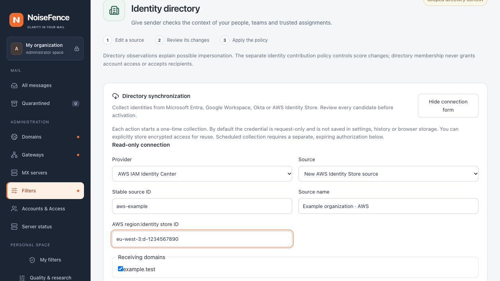

# AWS IAM Identity Center directory collection

Status: read-only collector in development builds. Installing NoiseFence does not
connect an AWS account. [Correspondent memory](contact-learning.md) learns from
accepted mail independently of this directory; recurring or listed senders never
receive an automatic allowlist exemption.

## Access and scope

Use **Filters → Identity protection → Directory synchronization**, select
**AWS IAM Identity Center**, and enter a source name, stable source ID and receiving
domains. The source authority is `region:identity-store-id`, for example
`eu-west-3:d-1234567890`. An unprefixed canonical UUID identity store ID is also
supported. Account names, store ARNs, custom endpoints, China and GovCloud
partitions are not accepted. The fixed endpoint is
`https://identitystore.<region>.amazonaws.com/`, using the connector's allowlist of
commercial [Identity Store regions](https://docs.aws.amazon.com/general/latest/gr/sso.html).

An AWS administrator must authorize these read actions for the intended store:

- `identitystore:ListUsers`
- `identitystore:ListGroups`
- `identitystore:ListGroupMemberships`

Supply **temporary STS credentials**: access key ID (`ASIA…`), secret access key
and session token. The three fields must belong to the same session. The caller
must already have permission to read the directory. NoiseFence does not assume a
role, create users, modify AWS resources, inspect account permission sets, read
mailboxes or discover credentials through environment variables/instance metadata.
Long-lived IAM keys are refused. Clock synchronization is needed for SigV4.

Choose **Start read-only collection** for a request-only credential. Secret fields
are cleared on submission; browser storage retains only the receipt UUID.
Optionally review **Store encrypted access for reuse**, for at most one hour.
An earlier STS expiry still applies; the entered lifetime cannot extend it.
[Saved access](directory-credential-storage.md) is bound to the administrator,
source, authority and generation. A collection schedule needs separate expiring
authorization. There is no token refresh or unattended role renewal yet.

## Collection and review

The collector signs only three fixed AWS JSON read operations. These use HTTP
POST, as required by the AWS protocol; no mutation operation is exposed. Requests
use TLS verification, no proxy discovery or redirect following, and a fresh SigV4
signature on each retry. A failed collection preserves the installed directory.

A full candidate includes all returned users, groups and each group's memberships.
Read the completion receipt, select **Review collected changes**, then use the
normal **Review and apply** policy flow. Nothing is activated by collecting or
saving access. Existing protected assignments are preserved by immutable ID;
missing protected identities require reconciliation. Source scope and authority
cannot be changed by provider data or by replacing a credential.

| Provider field | Interpretation |
| --- | --- |
| IdentityStoreId and immutable resource IDs | Exact store check and source-scoped identity keys |
| DisplayName, otherwise given/family name | Display name; missing/invalid names refuse the candidate |
| Emails.Value | Explicit addresses only; UserName is never treated as a mail alias |
| UserStatus ENABLED / DISABLED | Active / inactive |
| Missing or unfamiliar UserStatus | Unknown, never inferred active from account existence |
| Groups | Existing groups; no inferred mail address, protected role or account permission |
| GroupMemberships.MemberId.UserId | Direct links to users in this same complete candidate |
| Permission sets, roles, delegation and shared mailboxes | Not inferred or collected |

AWS exposes [user status and email fields](https://docs.aws.amazon.com/singlesignon/latest/IdentityStoreAPIReference/API_User.html).
Older responses without status remain readable but cannot establish an active
identity. A directory entry does not prove that an email was sent by that person;
SMTP authentication and recipient-specific history remain separate evidence.

*Local browser capture; no credentials, connected AWS account or activated source.*

## Bounds and failure handling

Pages contain at most 100 objects. The default whole-job budget is 300 seconds,
4,096 requests and 64 MiB; each successful response is limited to 2 MiB and error
responses to 16 KiB. Snapshot limits also apply: 20,000 people, 5,000 groups,
100,000 memberships and 16 MiB per source. A large store may exceed the request
budget before those object limits because each group's memberships need a call.

A page receives at most three attempts for throttling or temporary server errors;
retry delays above ten seconds defer to a later complete collection. Access
refusal, expired credentials, redirects, malformed pages, cross-store objects,
duplicate IDs, dangling users, repeated cursors and exhausted budgets fail the
whole candidate. Provider error text and credential material do not enter receipts.
A paginated read is not an atomic AWS snapshot. Concurrent directory changes can
abort a collection; verify coverage and unexpected reductions before activation.

There are no real-time AWS calls in SMTP. Installed directories are replicated as
reviewed immutable policy artifacts. New Web sources become stale after 24 hours;
stale/unavailable identities do not establish safety or spam.

## Verification and current limits

Offline tests cover pagination, disabled and unknown users, explicit addresses,
store binding, partial failures, budgets, retries, admin/CSRF boundaries, encrypted
access and durable reviewed candidates. A deterministic signature fixture was
independently generated with botocore 1.42.59 using synthetic credentials and a
fixed clock. No real AWS tenant validation or detection-rate claim follows from
these tests. Saved AWS credentials are a new typed vault record: older builds
cannot use them; downgrade with saved AWS access is not qualified. Delta reads and
renewable workload access remain future work. Local protection-role, group and
delegation edits use the [reviewed source editor](identity-protection.md#protect-synchronized-identities);
they do not modify AWS identities or renew the source's synchronization time.

Protocol references: [ListUsers](https://docs.aws.amazon.com/singlesignon/latest/IdentityStoreAPIReference/API_ListUsers.html),
[ListGroups](https://docs.aws.amazon.com/singlesignon/latest/IdentityStoreAPIReference/API_ListGroups.html),
[ListGroupMemberships](https://docs.aws.amazon.com/singlesignon/latest/IdentityStoreAPIReference/API_ListGroupMemberships.html),
[SigV4](https://docs.aws.amazon.com/IAM/latest/UserGuide/reference_sigv-create-signed-request.html).
