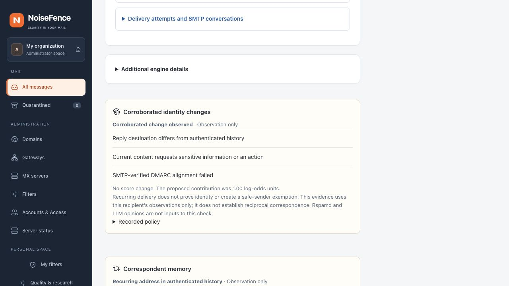

# Corroborated identity contributions

This development feature connects the recipient-scoped directory and automatic
correspondent memory to the existing content risk index. It defaults to
**observation**. No production policy, model or threshold is changed by installing
a build that contains this code. Detection accuracy remains unqualified on an
independent dataset.

## Web configuration

Open **Administration → Filters → Identity protection → Identity contribution**.
Choose **Observe changes only** or **Apply bounded contribution**, then set a
maximum between **0 and 1 log-odds unit** (default 1). Review and activate through
the normal shared-policy workflow on every MX. A missing setting means observation;
a stale settings client cannot silently erase an installed policy.

```toml
[identity_policy]
mode = "observation"
maximum_weight = 1.0
```

This setting can be used with the directory, automatic correspondent memory, or
both. It does not enable either source implicitly. The memory's collection switch
and retention limits remain independent. Setting the contribution to zero disables
weight while preserving observations. Global observation mode still prevents
filtering tags/quarantine under the ordinary action gates.

## Evidence required

The gateway must have its own completed SMTP authentication result and complete
local content features. Imported Authentication-Results, LLM prose and Rspamd
opinions are not evidence for this check. A local native content symbol must
identify a sensitive request (credentials, a financial lure or a wallet secret).
An HTML form, urgency or a link alone is insufficient.

A contribution additionally requires either:

- A **recurring address with a changed reply destination**, and a completed,
  definitive aligned or failed DMARC result. Its historical baseline must meet
  the configured campaign/day requirements with no retained human-spam veto.
- A **protected directory name/group with a different address**, failed DMARC
  alignment, and a completely fresh, unambiguous directory view for that recipient.

These combinations are bounded risk observations, not automatic spam verdicts.
A new correspondent, frequent delivery, name/link novelty or failed authentication
alone adds nothing. A compromised account can still authenticate; successful
alignment does not suppress the first combination. Stale/partial history does not
become evidence that a sender or destination is new. An explicitly delegated,
active directory sender with aligned authentication does not create a protected
person-name mismatch. No delegation grants console or mailbox access.

## One fact, one contribution

`identity_change` is a single input to `content-evidence-combination-3`, capped at
one log-odds unit even when several identity observations match. The ledger retains
the **larger**, rather than the sum, of this input and the overlapping `reply_to`
heuristic. Its discarded entry names the retaining rule in `subsumed_by`.
Authentication and sensitive content remain their separately recorded facts;
novelty does not generate a second content/authentication weight.

Weights are not percentage points or probabilities. A separately calibrated
fusion decision keeps its own feature inputs; this rule changes only the content
index. Recipient thresholds, explicit rules, malware priority and delivery gates
remain authoritative. Each recipient's content index and immutable receipt are
recorded before applying custom rules, with no other recipient's contact data.

Message details show **Corroborated identity changes**, the proposal in observation
mode, and the actual retained ledger weight when contributions are enabled.
Missing inputs remain visible. Historical messages are never rescored by viewing
them. Added SMTP headers use the same recorded index/verdict as the console.



*Unedited local browser capture using synthetic example.test messages. Observation
mode; no provider call, real mailbox, deployment or measured performance shown.*

## Validation and limits

Synthetic tests cover new legitimate senders, insufficient days/campaigns, human
spam vetoes, incomplete checks, forwarded authentication failures, ambiguous/stale
directories, authenticated delegation, duplicate signals, repeated accounting,
recipient isolation and policy replication. These are regression tests, not a
capture-rate or false-positive measurement. Keep observation until independent,
time/campaign-separated human labels qualify the proposed contribution.

[Correspondent memory](contact-learning.md) documents learning eligibility and
retention. [Directory management](identity-protection.md) documents snapshot scope,
freshness and source collection. Reciprocal/outbound contact visibility is not
provided by inbound recurrence.
