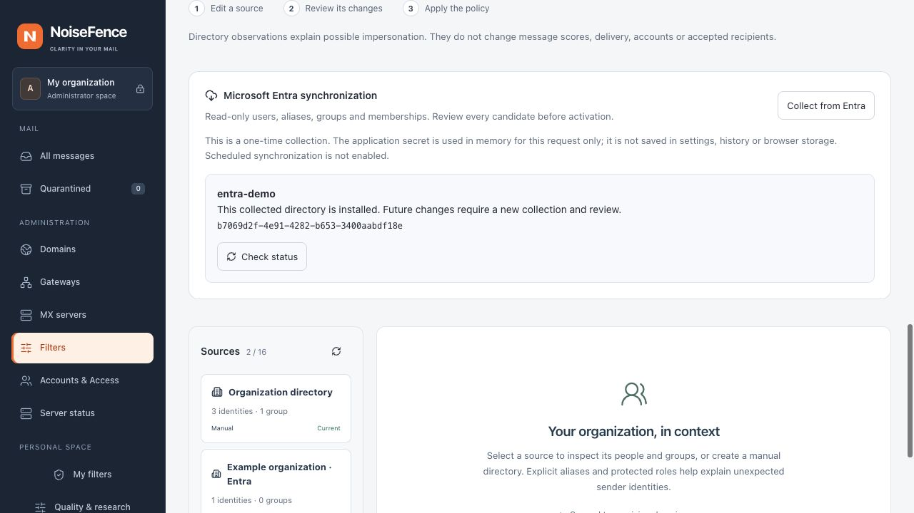

# Microsoft Entra directory connector (development)

## Current integration boundary

The native Rust connector collects a complete **candidate** directory from public
Microsoft Graph. The Web console now supports an administrator-triggered one-shot
collection, a durable result receipt and review before normal policy activation.
No live tenant was contacted for development validation. Optional encrypted
credential storage, replacement and revocation are available. Explicit [expiring schedules](directory-credential-storage.md#automatic-collection) reuse saved access; delta synchronization remains to be implemented.

Open **Administration → Filters → Identity protection → Directory
synchronization**. Select an existing Entra source or enter a new stable source ID,
name, tenant UUID and receiving domains. New sources use a 24-hour freshness window.
Supply the application UUID and secret directly in the HTTPS console, then start
collection. By default the secret is used only for that request. Alternatively,
select **Store encrypted access for reuse**, choose a lifetime (at most 90 days),
review and save. Use **Collect using saved access** to start a job separately.
See [credential storage](directory-credential-storage.md) for rotation, revocation
and backup requirements. Secrets never enter policy exports, audit records, job
receipts or browser storage.

The browser retains only the operation UUID in session storage. It sets that ID
before submission, so **Check status** can recover a response lost after acceptance.
A server restart does not automatically resume collection: unfinished jobs show
**No completion receipt**, not a fabricated success or proof that the provider
failed. No result is automatically retried or activated.

A ready result opens the existing count-based change review. Add it to the policy
draft, then use **Review and apply**. This uses the existing selected PostgreSQL
or local authority and MX activation protocol. A changed base revision or directory
digest requires another collection. Existing administrator-owned protected roles,
protected groups and delegations are retained; remote claims cannot overwrite them.
A missing protected identity refuses preparation for explicit administrative review.
New provider records receive no invented protected roles or mailbox grants.

The HTTP boundary authenticates administrator role, MFA and CSRF before reading
at most 16 KiB in ten seconds. A collection has a 300-second network budget and
a 350-second overall deadline. A 360-second receipt lease prevents overlapping
collections for the same source; at most two collections and 20 starts per hour
are allowed. Receipt transitions are serialized in the selected authority, with
no local database fallback when PostgreSQL is selected. The existing append-only
audit journal stores bounded intent and terminal receipts (16 KiB each), not raw
directory records. Normal audit retention applies. Unknown outcomes retain their
lease until its deadline; they do not authorize automatic restart.

Successful candidates are immutable private artifacts. Collection does not hold
the policy activation lock while waiting for Microsoft, and SMTP never waits for
it. Preparation rechecks session privileges and the exact installed revision;
activation rechecks them separately. Loss of the outcome write leaves an explicit
unknown receipt, possibly an unused artifact, and the installed policy unchanged.

`POST /api/v1/admin/identity/sync/entra` accepts `operation` (UUID), `revision`,
`catalog_sha256`, `source`, `client_id` and `client_secret`, returning HTTP 202 with
the receipt ID. `GET /api/v1/admin/identity/sync/{id}` is administrator-only and
returns `running`, `ready`, `failed` or `outcome_unknown`, installed/stale flags and, when
ready, the prepared selection and change counts. Neither endpoint activates it.
The existing PostgreSQL v1 schema checksum is unchanged; optional additive audit
lookup indexes are installed by the normal explicit database migration command.



*Synthetic local demonstration. This image does not show a connected tenant.*

## Authentication and requested data

The source authority is the Entra tenant UUID. Client credentials are acquired
at that exact tenant's `login.microsoftonline.com` token endpoint, using the
Graph `.default` scope. The source authority must match the credential tenant
before any network request. Credentials are not serialized or debug-formatted;
HTTP authorization headers are marked sensitive. TLS validation remains enabled,
redirects are refused, and environment HTTP proxies are not inherited.

Only the following Graph v1.0 collections are requested:

| Collection | Selected properties |
| --- | --- |
| `/users` | `id`, `displayName`, `mail`, `proxyAddresses`, `accountEnabled` |
| `/groups` | `id`, `displayName`, `mail`, `proxyAddresses` |
| `/groups/{id}/members` | `id`, with the returned OData object type |

Start with read-only application permissions appropriate to these endpoints,
including `User.Read.All` and `GroupMember.Read.All`, with administrator consent.
Validate property visibility in the intended tenant. Hidden membership requires
`Member.Read.Hidden`; a denied membership read aborts collection. No directory
write, mail-body or sign-in-event permission is requested by this connector.
See Microsoft's [user collection](https://learn.microsoft.com/en-us/graph/api/user-list?view=graph-rest-1.0),
[group collection](https://learn.microsoft.com/en-us/graph/api/group-list?view=graph-rest-1.0),
[membership permissions](https://learn.microsoft.com/en-us/graph/api/group-list-members?view=graph-rest-1.0)
and [application authentication](https://learn.microsoft.com/en-us/entra/identity-platform/v2-oauth2-client-creds-grant-flow).

The initial authentication implementation uses a client secret. Certificate and
workload-identity credentials, sovereign Graph clouds and persisted delta cursors
are not implemented here. Optional saved client secrets use the separate
encrypted connection lifecycle, never source snapshots or public settings exports. There is no reason to paste a secret into chat.

## Mapping and authority

- IDs come from immutable provider object IDs, scoped to the configured source.
  Names, aliases and group membership never become console accounts or grants.
- Only `mail` and explicit `SMTP:`/`smtp:` proxy addresses are email identities.
  Login names, `userPrincipalName`, dots and plus tags do not create aliases.
  Local-part case is retained; domain case and IDNA are normalized.
- `accountEnabled` maps to active, inactive or unknown. Missing/null state does
  not become active. A disabled sign-in account is not proof that an Exchange
  shared mailbox is inactive: mailbox kind and delegation need their own explicit
  authoritative input and are not inferred by this collection.
- Returned groups represent existing directory groups. Only person and group
  membership edges enter the current identity model. Devices, service principals
  and organizational contacts are counted as excluded types; no claim of a
  complete tenant-object inventory is made. Unknown types, duplicate IDs or
  unresolved person/group edges abort the candidate.
- Remote payload fields cannot set protected roles, group protection, receiving
  scopes or delegation. The separate administrator-owned
  `identity::protection::Selection` binds to the exact source configuration and
  applies those choices after collection. A missing protected ID or invalid
  delegation must be resolved explicitly, not silently discarded by a refresh.

The candidate is validated as a whole, including graph references, cycles,
alias limits and serialized size. Microsoft Graph listings can be eventually
consistent; this is not a point-in-time transaction across remote collections.
A missing referenced member causes a failed attempt and later retry, not a
partially reconstructed group.

## Bounded collection and failure handling

| Boundary | Value |
| --- | --- |
| Whole authentication + collection deadline | 300 seconds by default; configurable 1–900 |
| HTTP request timeout / connection timeout | 15 seconds / 5 seconds |
| Request budget, including retries | 4,096 by default; configurable 1–10,000 |
| Cumulative response budget | 64 MiB by default; configurable 1 KiB–128 MiB |
| One successful Graph page | 2 MiB |
| Token response | 64 KiB |
| Objects in the resulting snapshot | 20,000 people; 5,000 groups; 100,000 memberships |
| Final serialized source snapshot | 16 MiB |
| Per-person/group email addresses | 32 explicit addresses |

Every next-link must stay on HTTPS `graph.microsoft.com`, the same exact
collection path and the same selected properties. Only bounded page size and an
opaque pagination token may vary. Userinfo, fragments, alternate ports, resource
changes, filters, expansion and repeated query keys are rejected. Repeated
continuation URLs, invalid JSON, a delta response in a full collection, truncated
streams and exceeded budgets abort the entire attempt. See Microsoft's
[pagination contract](https://learn.microsoft.com/en-us/graph/paging).

HTTP 429/503 may retry at most twice, within the same request and time budgets.
A requested delay over ten seconds stops this attempt for a later job; it is not
shortened and immediately retried. Invalid or date-form Retry-After values are
also deferred conservatively. Other HTTP failures and network failures end the
attempt. Raw error bodies, opaque next-links and tokens are not included in
reported errors.

Collection returns no partial snapshot on failure. The publishing job must keep
the installed last-good snapshot, report the failure and let normal freshness
expiry mark that source unavailable. A successful empty source still passes
through the existing deletion-review gate: it is not automatic permission to
erase an active directory. Snapshot publication and administrator selections
must be included in the same reviewed activation as their source scope.

## Validation

Synthetic fixtures live in `tests/fixtures/identity/entra/`. Tests cover multiple
pages, explicit aliases, activity, hostile continuation URLs, secret-safe errors,
authority mismatch before network, rate limits, object/byte/request limits,
partial responses, duplicates, missing members and deletion review. Local TLS
fixtures exercise the actual HTTP transport, redirect refusal and both declared
and streamed response-size limits. No real credentials or tenant data are used.

Run the targeted checks from the repository root:

```sh
cargo test --locked --lib identity::
cargo clippy --locked --lib --example identity_probe -- -D warnings
```

The job journal and local/API workflow are exercised with synthetic fixtures and
a disposable PostgreSQL instance. Live tenant interoperability, production key
recovery, independent filtering evaluation and a live two-MX provider
publication remain to qualify.
Passing these fixtures does not demonstrate phishing capture or a false-positive
rate.

## Collection coverage

The review receipt includes request, page and byte totals, plus excluded member
counts. Devices, service principals and organization contacts are not imported as
people or group edges. Exclusions require attention in the review. These counts
are preserved in the selected authority's durable receipt and remain visible after
a restart. A receipt from an older build can lack coverage details; absence is not
a claim of complete coverage. Provider permissions still bound visible records.
