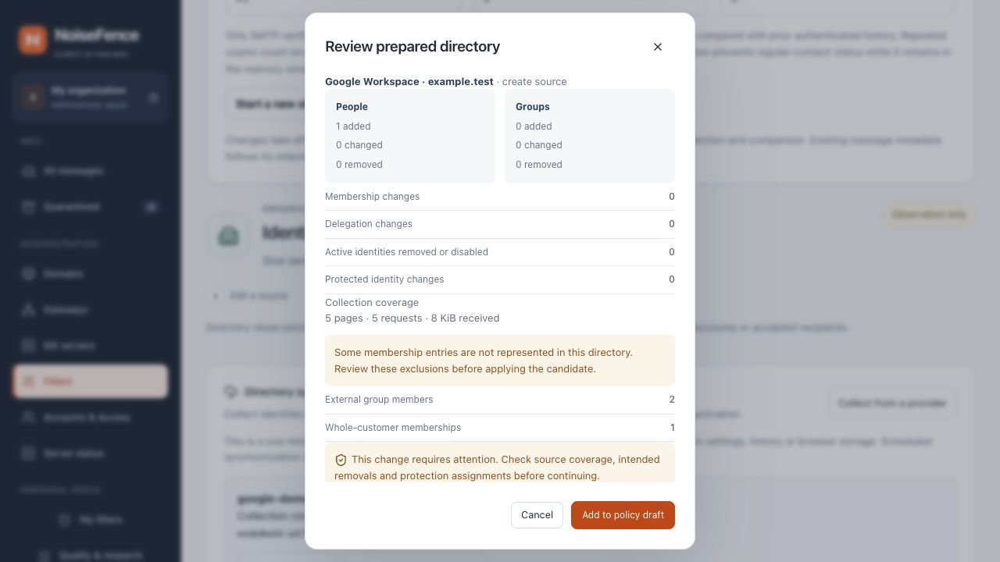

# Google Workspace directory collection

Status: native, read-only one-shot collection in development builds. Installing
NoiseFence does not connect a Google customer. No live provider has been used in
local validation. Scheduled refresh, delta collection and saved credentials are
not implemented yet.

The independent [automatic correspondent memory](contact-learning.md) learns
recurrence from accepted authenticated messages without an identity provider.
A directory supplies organization context; neither membership nor frequency is
a trusted-sender exemption, a training label or a mailbox-access grant.

## Prepare read-only access

Use the immutable customer ID (for example `C01234567`), not `my_customer`, an email
domain or a URL. Supply a short-lived OAuth access token with these scopes:

- `https://www.googleapis.com/auth/admin.directory.user.readonly`
- `https://www.googleapis.com/auth/admin.directory.group.readonly`
- `https://www.googleapis.com/auth/admin.directory.domain.readonly`

The authorized administrator must have visibility of the intended directory.
Scopes alone do not prove completeness. Confirm visibility and review unexpected
reductions before activating a candidate. No Gmail scope is requested. NoiseFence
does not create service accounts, store private keys or refresh tokens, or obtain
an access token on the administrator's behalf. Do not paste credentials into chat.
See Google's [user-list permissions](https://developers.google.com/workspace/admin/directory/reference/rest/v1/users/list),
[group-list permissions](https://developers.google.com/workspace/admin/directory/reference/rest/v1/groups/list)
and [domain-list permissions](https://developers.google.com/workspace/admin/directory/reference/rest/v1/domains/list).

## Collect and review

1. Open **Filters → Identity protection → Directory synchronization** and select
   **Google Workspace**.
2. Choose an installed source or enter a source ID, name, customer ID and receiving
   domains. Each scope must be a configured receiving domain and a verified domain
   or domain alias reported by that Google customer.
3. Enter the access token without the `Bearer` prefix, then start collection.
   The field clears on submission. Only the receipt UUID is retained in browser
   session storage; the token is not saved in settings, receipts or audit records.
4. Open **Review collected changes**. Check additions, removals, inactive identities,
   protected assignments and **Collection coverage**, including excluded members.
5. Add the candidate to the policy draft, then **Review and apply** through the
   normal revision checks and coordinated MX activation.

New sources use a 24-hour freshness window. Existing authority, scope, freshness
and administrator-owned protection assignments are preserved. A missing protected
identity refuses preparation; reconcile it explicitly. Google admin/group-owner
roles are not converted into NoiseFence protected roles or sending delegation.

*Unedited local browser capture with synthetic identities, token and responses.
It is not a connected Google customer or production activation.*

## Mapping and exclusions

Users are fetched with `showDeleted=false`, so deleted users disappear from the
candidate and appear in the removal review. Suspended and archived accounts stay
as inactive identities. An account is active only when suspended, archived and
guest flags are all explicitly false; missing status is unknown.

Immutable user and group IDs are source-scoped. Only primary email and explicit
aliases, including non-editable domain aliases, are imported as addresses. Login
hints, recovery addresses, arbitrary profile fields and administrator claims are
not inferred as aliases. See the [user resource](https://developers.google.com/workspace/admin/directory/reference/rest/v1/users).

Direct active USER and GROUP memberships become edges only when the referenced
record and email agree with the collected directory. Nested groups are kept as
edges; duplicates and cycles refuse the candidate. These exclusions are counted
and displayed before review:

| Membership | Treatment |
| --- | --- |
| External user or group outside the customer's domains | Excluded; no invented person or supplier trust |
| Whole-customer membership | Counted, not expanded to every user |
| Inactive or missing membership status | Counted, not treated as an active edge |
| Missing internal reference, mismatched address or unknown member type | Refuse the whole candidate |

See the [member resource](https://developers.google.com/workspace/admin/directory/reference/rest/v1/members)
and [direct membership listing](https://developers.google.com/workspace/admin/directory/reference/rest/v1/members/list).
No exclusions does not prove that provider permissions exposed the full tenant.

## Failure and resource boundaries

All requests are GETs to fixed `admin.googleapis.com` endpoints. TLS certificates
are verified; redirects and environment proxies are disabled. Opaque page tokens
remain encoded query values on the same resource and customer. They cannot change
the destination host. Repeated tokens, malformed pages, unknown response kinds,
wrong customer IDs, missing permissions and resource limits refuse the candidate.

Defaults: 300-second collection budget; 4,096 requests and 64 MiB total; 2 MiB per
response; 200 rows per paginated request. At most two retries are made for 429 or
502/503/504 responses; retry delays over ten seconds are refused. Other errors,
including quota-related 403 responses, fail without pretending to have collected
a complete source. There is no background retry or token refresh.

Collection, preparation and activation are separate. Failures or lost result writes
leave the installed directory unchanged. The shared receipt state machine is
[documented with the Entra connector](identity-entra.md). Receipts use the selected
PostgreSQL or local authority; they include bounded coverage counters, never raw
provider error bodies, access tokens or member identifiers.

`POST /api/v1/admin/identity/sync/google` accepts `operation`, `revision`,
`catalog_sha256`, `source` with `provider: "google"`, and request-only `access_token`.
Administrator authorization, MFA when configured and CSRF are checked before reading
the bounded request. HTTP 202 returns a job ID. Read its authorized result at
`GET /api/v1/admin/identity/sync/{id}`. No endpoint automatically activates a result.
