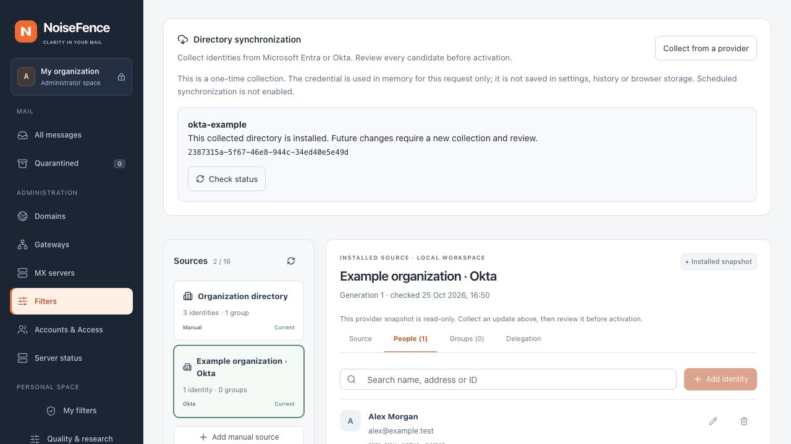

# Okta directory collection

Status: native, read-only one-shot collection in development builds. No production
org is connected by installing NoiseFence. Collection does not enable SSO, grant
console access, accept SMTP recipients or change a message verdict.

The independent [automatic correspondent memory](contact-learning.md) learns from
accepted mail without an identity provider. An Okta directory adds organization
context; a listed or regular sender is not automatically trusted.

## Prepare access

Use the standard org hostname, for example `company.okta.com`,
`company.okta-emea.com` or `company.oktapreview.com`. The hostname is the source
authority, not a receiving mail domain. Custom aliases, government domains,
nested hostnames, URLs, ports and paths are not supported by this connector.
See [Okta org URLs](https://developer.okta.com/docs/concepts/okta-organizations/).

Supply an existing short-lived OAuth access token issued for the org management
API, with `okta.users.read` and `okta.groups.read`. Do not include the `Bearer`
prefix. The application also needs an appropriate read-only admin role and
resource set covering the intended users and groups. Scopes alone do not prove
complete visibility. Restricted permissions may return only part of an org;
verify visibility before approving the first import or an unexpected reduction.
See [Okta scopes](https://developer.okta.com/docs/api/oauth2) and
[admin permissions](https://developer.okta.com/docs/api/openapi/okta-management/guides/permissions).

NoiseFence does not create credentials, mint or refresh Okta tokens, store private
signing keys, or accept SSWS API tokens. No mail-content or mailbox permissions are
requested. No live provider test is implied by the local fixture tests.

## Collect and review

1. Open **Filters → Identity protection → Directory synchronization**.
2. Select **Okta**, then choose an installed source or enter a stable source ID,
   source name, org hostname and the receiving domains it may inform.
3. Enter the OAuth token and choose **Start read-only collection**. The browser
   clears its credential field. Only the operation UUID is kept in session storage.
   Optional **Store encrypted access for reuse** retains the token for at most
   one hour after confirmation. Use **Collect using saved access** separately;
   see [credential storage](directory-credential-storage.md). Earlier provider
   expiry applies. Saving alone does not enable a schedule or token refresh.
4. Read the completion receipt, then choose **Review collected changes**. Check
   additions, removals, inactive identities, scope and protected assignments.
5. Add the candidate to the policy draft and use **Review and apply**. The normal
   revision, authorization and coordinated MX activation checks still apply.

New Web-created sources expire after 24 hours without a new completed collection.
An existing source keeps its authority, scopes and freshness settings; collection
cannot rewrite them. Existing local protection assignments are preserved. A
missing protected ID refuses preparation and requires explicit reconciliation.
Provider role/delegation editing is not yet available in the console.

*Actual local browser capture using synthetic identities and a simulated provider
response. This is not a connected Okta org or a production activation.*

## Data mapping and completeness

The connector reads users, groups and each group's user membership using GET
requests only. It paginates both the default user list and a separate
`status eq "DEPROVISIONED"` list: Okta omits deprovisioned accounts from the default
list. The latter accounts remain in the candidate as inactive identities.
See the [official user-list API reference](https://developer.okta.com/okta-sdk-java/25.0.0/apidocs/apidocs/com/okta/sdk/resource/api/UserApi.html).

| Okta data | NoiseFence interpretation |
| --- | --- |
| Immutable user/group ID | Source-scoped identity key; names and addresses are not IDs |
| User display name, or first and last name | Display name; missing/invalid names refuse the candidate |
| Explicit `profile.email` | One email address |
| `profile.login`, `secondEmail`, custom profile fields | Not inferred as aliases or trusted addresses |
| `ACTIVE` | Active account observation |
| `SUSPENDED`, `DEPROVISIONED` | Inactive account observation |
| Missing or other status, including password expiry and lockout | Unknown activity; no claim about mailbox delivery |
| Group name and direct user membership | Identity context; no inferred mailing-list address |
| Protected roles, shared mailboxes, suppliers, delegation | Not inferred from provider profile fields |

Pagination is not a point-in-time snapshot. Duplicate IDs, inconsistent user sets,
unknown group kinds, duplicate memberships and references to users missing from
the collected inventory refuse the candidate. Other concurrent provider changes
can remain undetectable; review and freshness still matter. No delta query,
`search` or user-picker `q` query is used to replace the directory.

Every next-page URL must retain the same HTTPS org, resource, page size and
collection filter. Credentials cannot follow redirects or a changed host.
Ambiguous/unsupported Link headers, loops and unknown query parameters fail the
collection rather than silently treating a partial result as complete.

## Limits, failures and privacy

Defaults: 300 seconds for the collection, 4,096 requests, 64 MiB total response body
bytes, 2 MiB per page, 200 objects per requested page, 20,000 users, 5,000 groups
and 100,000 memberships. TLS certificates are verified; environment proxies and
HTTP redirects are disabled. Requests have a five-second connection timeout and
a 15-second overall timeout.

HTTP 429/503 receive at most two retries per page within those budgets. Retry-After
or Okta's rate-limit reset is honored only within a ten-second wait; longer or
invalid values end this attempt. Authorization errors are not retried. Error
bodies and URLs are not copied into logs, receipts or browser errors.

The default form uses the token only for the bounded invocation. Explicitly
saved access is encrypted in the management connection repository. Neither mode
writes the token to settings, snapshots, queue records or audit receipts.
Treat the server and browser as credential-handling systems nevertheless;
short lifetime and restricted read access remain necessary.

The shared durable receipt records operation ID, source, base revision, deadline
and the terminal result in the selected management store (SQLite or PostgreSQL).
Two jobs may run concurrently, one per source, with 20 starts per hour. The HTTP
request is detached from collection. An unknown outcome after restart is not a
successful collection and does not activate an artifact. A retry must check the
existing receipt and wait for any outstanding lease. Token expiry, failed reads
or exhausted limits leave the installed directory in place; stale installed data
is reported as unavailable. Optional [expiring schedules](directory-credential-storage.md#automatic-collection) reuse stored access with bounded backoff; they do not refresh the token.

## API

`POST /api/v1/admin/identity/sync/okta` accepts an administrator session, CSRF,
current revision and installed catalog digest, an operation UUID, a configured
`source` with `provider: "okta"`, and the request-only `access_token` string.
The bounded request returns HTTP 202 with its operation ID and deadline.
`GET /api/v1/admin/identity/sync/{id}` reads its authorized receipt.

The job states and review semantics are shared with
[Entra collection](identity-entra.md). Arbitrary directory JSON cannot be submitted
through a provider endpoint. Preparation, collection and activation remain distinct.
