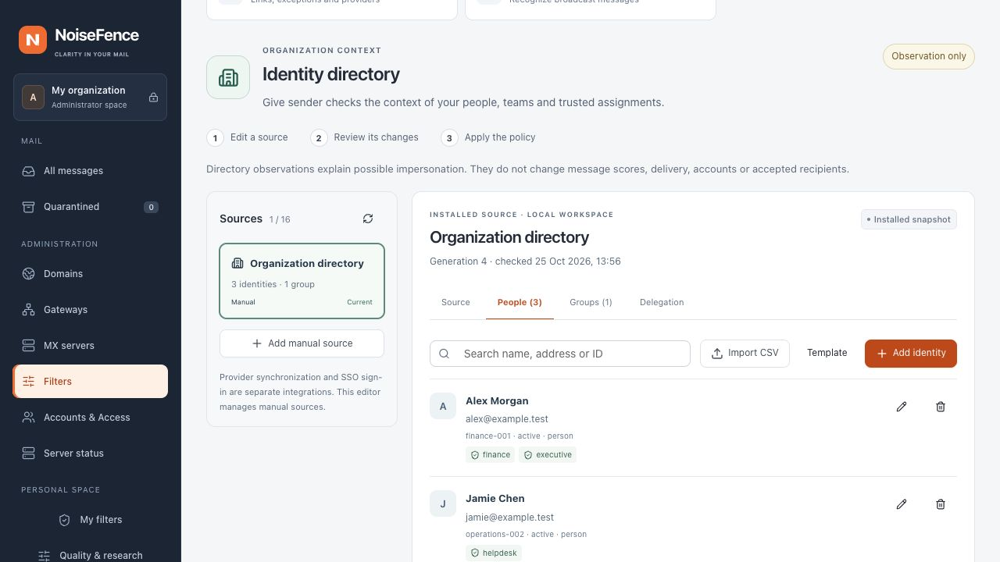
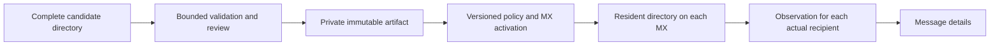

# Identity protection

## Available in the console

**Administration → Filters → Identity protection** brings together a manual
organization directory, protected-name checks and per-message observations.
This development version adds administrator source management through the existing
configuration review and MX activation workflow. It defaults to observation and preserves installed models, thresholds and delivery
policy. The separate [identity contribution](identity-correlation.md) can change
the content index only after explicit configuration and reviewed activation.

| Capability | Status |
| --- | --- |
| Manual directory sources, people, aliases, groups and protected roles | Administrator Web editor and authorized preparation API |
| Nested memberships and explicit sending delegation | Editable assignments; references and group cycles validated before preparation |
| Source freshness, search and people CSV import | Available; imported rows are reviewed before activation |
| Protected names and expected sending domains | Separate domain-based check editor, with its own CSV format |
| Immutable catalogs and per-recipient SMTP observations | Distributed with the versioned MX policy; displayed in message details |
| Active Directory internal collection | Windows LDAPS/Kerberos collector, explicitly enrolled public key, signed export upload and reviewed activation; real AD qualification remains required |
| Entra, Google Workspace, Okta and AWS Identity Store full directory collection | Read-only Web collection, optional encrypted access and expiring schedules; durable results require review |
| Automatic correspondent memory | Recipient-scoped, retained SMTP observations with Web controls |
| Corroborated identity contribution | Optional bounded, deduplicated content weight; observation by default |
| Other directory providers, SSO and reciprocal contact graph | Further integration work; no connected tenant or outbound history is claimed |



*Local browser capture with synthetic identities, revision and availability. It is
not production data, a connected identity provider or evidence of detection accuracy.*

See [Automatic correspondent memory](contact-learning.md) for learning from accepted,
authenticated mail without manual labels. It works without a directory connection.

The [directory credential guide](directory-credential-storage.md) describes
optional encrypted access, expiry, replacement and revocation from the Web console.
One-time request-only access remains the default; optional schedules require a separate expiring authorization in [Saved directory access](directory-credential-storage.md#automatic-collection).

## Manage a manual directory

1. Open **Filters → Identity protection → Add manual source**. Give the source a
   readable name, a stable ID and an authority identifying your organization.
   Choose one or more **installed receiving domains**. The authority and source
   ID are immutable after creation; use a new source for a different authority.
2. In **People**, add people, shared mailboxes or supplier contacts. Give each a
   stable source-local ID, display name, explicit addresses/aliases and activity.
   Assign protected roles such as finance, executive, helpdesk or legal where
   appropriate. Do not use changing names or email addresses as immutable IDs.
3. In **Groups**, create ordinary or protected groups and add people or nested
   groups as members. Groups need not have a mail address. Cycles, missing objects
   and self-membership are rejected during preparation.
4. In **Delegation**, select an address owner, one of their explicit addresses and
   an authorized delegate. This records an existing assignment; it does not grant
   permissions at your upstream mail provider.
5. Select **Prepare changes**. The server validates the entire candidate, records
   the authorized preparation and stores an immutable artifact. Review the counts
   of added/changed/removed objects, memberships and delegations. Large removals,
   protected-identity changes and source configuration changes are highlighted.
6. Select **Add to policy draft**, then **Review and apply** at the bottom of the
   configuration page. Follow the normal activation panel for every required MX.
   A prepared artifact is not active. Apply or discard that policy draft before
   preparing another source, so successive changes cannot silently replace one
   another's catalog.

Search covers IDs, names and explicit addresses. Lists show 25 results per page.
Removing an identity also removes its memberships and delegations in the local
workspace. **Remove source** prepares a separate, reviewed source removal. Other
sources are retained. Changing source or leaving administration while edits are unsaved requires
confirmation. Use **Discard local edits** to restore the loaded source without
discarding unrelated configuration changes.

A manual source can remain current for 5 minutes to 30 days (default: 30 days).
Inspect its assignments, then select **Renew reviewed source** to prepare a new
reviewed generation. Viewing or retrying a source never renews it. Stale data stays
visible but cannot corroborate an identity finding. Unknown activity is distinct
from an active account. The console does not manufacture provider synchronization.

### Import people by stable ID

Use **People → Template** or this exact UTF-8 CSV structure:

```csv
id,name,addresses,kind,activity,roles
finance-001,Alex Morgan,alex@example.test;finance@example.test,person,active,finance;executive
shared-finance,Accounts payable,accounts@example.test,shared_mailbox,active,finance
```

The import accepts up to 4 MiB and 20,000 rows. Quoted fields, doubled quotes,
UTF-8 BOM and LF/CRLF are supported. Separate addresses and roles with semicolons.
Allowed kinds are `person`, `shared_mailbox`, `supplier`; activity is `active`,
`inactive` or `unknown`; roles are `executive`, `finance`, `helpdesk`, `legal`,
`supplier`, `custom`, or an empty field. IDs must be unique in the import.

Preview reports new and changed identities. Matching IDs replace the fields of
that person; people absent from the file are retained. Groups, memberships and
delegations are preserved. A replaced address that invalidates a delegation must
be corrected before the server will prepare the source. Parsing failure leaves
the local workspace unchanged. Email local-part case, dots and plus tags remain
significant; only domain case is normalized by the editor. Use ASCII/punycode
email domains. CSV fields are text, never evaluated as spreadsheet formulas.

### Authorization and API

Both APIs require a current administrator session, including MFA when enabled.
Preparation additionally checks same-origin CSRF protection before reading a body.
Mailbox users cannot fetch directory names or assignments.

| API | Purpose |
| --- | --- |
| `GET /api/v1/admin/identity` | Installed revision, digest, source counts and freshness |
| `GET /api/v1/admin/identity?source=SOURCE_ID` | The selected source's editable content |
| `POST /api/v1/admin/identity/prepare` | Prepare an `upsert_manual` or `remove` operation; never activate it |

Preparation accepts `revision`, `catalog_sha256` (null for no installed catalog)
and `edit`. A manual upsert has `operation: "upsert_manual"` and a `draft` with
`source`, `people`, `groups`, `memberships`, `delegations`; removal uses
`operation: "remove"` and `source_id`. Source shape follows
[`directory.rs`](../src/identity/directory.rs). Generation and completion time are
assigned by the server, not imported as proof of a successful provider sync.

The response contains the selection, its exact previous digest and a change review.
The existing configuration API remains the only activation path. Stale base
revision/digest returns HTTP 409; a rejected preparation cannot replace the loaded
snapshot. A client must reload and review after conflict, not automatically retry
against a newer base. Source, authority, scope, references and total bounds are
checked server-side, even if the browser was bypassed.

Uploads are limited to 16 MiB plus 64 KiB of request metadata, 30 seconds and two
concurrent API slots. Complete catalogs contain at most 16 sources and 64 MiB.
Prepared artifacts are private and bounded to 32 files / 128 MiB; when capacity is
exhausted, preparation fails without altering the installed catalog. Automated
cleanup is not implemented: retain referenced drafts and policy artifacts, and
review unused preparations before maintenance. Do not delete the active or pending
policy's files. In PostgreSQL mode, authorization and preparation audit are central;
files remain local content-addressed artifacts before normal policy distribution.
Audit distinguishes started, completed and failed preparation. A completed
preparation is not an activated policy.

## Configure protected names

1. Open **Filters → Identity protection → Domain-based name checks**. If additional protection is disabled,
   follow **Open protection settings** to enable the installed module. Server
   installation and availability remain separate from the draft toggle.
2. Enable **Observe identity signals**. Add a name and its usual sending domain,
   for example `Alex Morgan` and `example.test`. The list applies to all receiving
   domains on this installation. It does not create mailboxes or console users.
3. Search by name or domain to narrow the list. Selection applies only to visible
   rows when using **Select visible**; an existing explicit selection can include
   rows hidden by a later search. Removal confirms the exact selected mappings.
   Editing rows or reloading the configuration invalidates earlier selections.
4. Use **Review and apply**, inspect the before/after values, then apply or stage
   the settings. Follow the existing activation panel until every required MX has
   installed the revision. The loaded revision shown by the editor is not a claim
   that a new draft has reached the MXs.

Turning off identity observations retains the names. Removing names only changes
the draft until application. Already accepted messages retain their recorded
analysis. Administrator permissions, session/CSRF checks, concurrent-revision
validation and coordinated activation use the existing configuration API.

A protected display name is matched after trimming and case normalization; there
is no fuzzy person-name matching. Domains are compared by registrable domain
using the detector's Public Suffix List. Subdomains are not separate identities.
The editor requires an ASCII domain (use punycode for international domains),
without a URL, address, wildcard or trailing dot. Names must occupy 3–100 UTF-8
bytes and contain no control or invisible formatting characters.

**Multiple domains for one name are not an allowed-domain list.** The existing
detector evaluates each mapping independently. The editor highlights such
mappings, and CSV imports refuse to introduce them. Aliases, homonyms, delegated
senders and shared mailboxes require explicit directory semantics; do not treat
this list as an organizational directory or a safe-sender bypass.

## Import names from CSV

Download the template from the editor or create a UTF-8 file:

```csv
name,domain
Alex Morgan,example.test
"Finance, Europe",example.test
```

The exact header is `name,domain`. Quoted commas and doubled quotes are supported,
as are a UTF-8 BOM and LF/CRLF line endings. Limits are 64 KiB and 100 data rows;
the resulting list may contain at most 100 mappings. Invalid encoding, quoting,
extra columns, names or domains reject the import before changing the draft.

Preview shows only additions and the number of duplicate rows skipped. Comparison
uses trimmed, case-normalized names and domains. Import is append-only: it never
replaces existing mappings. The preview is recalculated against the current
draft before addition. Importing, editing and downloading a template do not call
an identity provider. Only applying the configuration sends mappings to the
NoiseFence management API. CSV data is treated as text, not executed as formulas.

## Read a message's identity observations

Open a message, expand **Additional engine details**, and find **Complementary
protection → Identity observations**. It groups recorded name mismatches,
lookalike domains and different reply destinations, with their explanations and
technical identifiers. Other protection findings remain in their own list.

DMARC alignment authenticates a domain, not the person writing the message.
A mismatch may have a legitimate explanation, such as delegation or forwarding.
These observations are not independent spam votes and do not directly change
the current risk index or delivery. Read the saved NoiseFence verdict and action
separately; Rspamd remains a second opinion.

**No identity finding recorded** does not mean identity was verified. The legacy
report does not retain individual identity-check availability. Missing results,
inactive checks and unfamiliar correspondents must not be presented as verified
safety or proof of spam. Message details continue to use existing server-side
recipient permissions; the console does not return a directory to mailbox users.

## Native directory integration (development)

The native runtime can now load an immutable directory catalog during policy
preparation, distribute it as part of a versioned MX policy, and record an
observation for each actual SMTP recipient. Message details display this report
when present. Manual source management and authenticated preparation/review are
connected to the console. Entra, Google Workspace, Okta and AWS Identity Store one-shot collection use
request-only or explicitly saved encrypted credentials and a durable receipt.
Scheduled collection requires a separate expiring administrator grant; candidates still require review.
The [Entra](identity-entra.md), [Google Workspace](identity-google.md), [Okta](identity-okta.md) and [AWS](identity-aws.md) collectors return
candidates without publishing them. No directory connector or new directory policy is enabled in production;
the separately tagged release/deployment does not contain this development work.



The manual source workflow follows these boundaries. Provider collection is
separate; the diagram does not claim a connected external tenant.

### Persistence and policy identity

A catalog uses `identity-catalog-1`, contains at most 16 complete source snapshots
and occupies at most 64 MiB. Each source remains bounded to 16 MiB. Preparation
validates before writing a private file, synchronizes file and directory entries,
and never replaces existing bytes. A prepared file is not an active policy.

Settings select a SHA-256, never a client-supplied file path. Replacing or disabling
an installed catalog requires its exact digest in the review; changed source
snapshots must advance generation and completion time must not go backwards.
A different provider or authority requires a new source ID. Ordinary settings
saves retain the installed immutable artifact, even after its original upload is
removed. The selected management backend and its existing revision/activation
gates remain authoritative; no separate SQLite authority is introduced for a
PostgreSQL installation.

Catalog bytes are included in the policy artifact manifest and verified before
loading. They are excluded from the **model** manifest: updating the directory
must not change model identities or silently select installation model files.
An absent shared catalog disables directory observations on a worker rather than
falling back to a local installation catalog. Publication to an older build is
refused when a directory is selected. A missing or corrupt candidate fails
preparation; an expired source is reported as stale, never refreshed artificially.

### Recipient-specific message details

The **Directory identity** card is separate from legacy protected-name findings.
It shows fresh/applicable source counts, recorded SMTP authentication, ambiguous
matches, signals and the catalog digest. Historical messages without this report
are not assigned new observations retroactively.

The runtime projects a report for each envelope recipient before grouping delivery
variants. Different reports cannot share a wire variant. The separate correlation
policy can adjust the recipient's content index and recorded verdict when explicitly
enabled; it never turns frequency into a safe-sender exemption. Reports contain no
directory object IDs, names, other recipients' addresses or contact-history join
keys. Current complete local content analysis supplies sensitive-request evidence.
The directory detector's human-qualified relationship baseline remains unavailable;
automatic recurrence is separately identified. Loading and provider requests never
run inside SMTP processing.

## Trust model

An identity in a directory, authenticated email and a legitimate request are
three different facts. A compromised real account can pass authentication. An
unfamiliar correspondent may be legitimate. Directory observations therefore do
not authorize SMTP recipients, create console accounts, grant access, establish
safe senders or override malware/authentication checks.

The native observations will complement NoiseFence's HAM/PUB/SPAM decision.
Rspamd remains an independent second opinion. Changes will start in observation;
independent evaluation must precede any bounded contribution to the live score.

## Implemented foundation

`src/identity/directory.rs` defines source-scoped immutable IDs, people, shared
mailboxes, supplier contacts, explicit aliases, protected roles, groups,
memberships and explicit delegations. Activity is active, inactive or unknown;
unknown activity is not silently treated as active. Directory groups without
mail addresses do not acquire a made-up mailbox. Email local-parts retain case,
dots and plus tags; only domain case and IDNA are normalized.

Snapshots validate their full content, references, limits and nested-group cycles.
A source carries administrator-assigned recipient domains and a freshness limit.
Names and address collisions remain ambiguous, including collisions between
sources. The in-memory publisher validates before atomically replacing its Arc;
failed, stale-generation or partial input cannot erase the last good generation.
Private persistence, authorized manual preparation and immutable policy artifacts
use the existing activation gates. Scheduled provider jobs are not enabled. Corrupt/missing/stale data never proves spam or safety.

The source-change preview flags removal or deactivation of at least 20% of active
objects for review.
Changes to protected identities, protected group membership or delegation are also
flagged. Catalog replacement currently requires exact-snapshot review for every
update, including a successful empty collection. Review binds the exact previous and candidate digests; approval
cannot authorize a different update. Source configuration changes require a
separate revision rather than an IdP response changing its own authority/scope.

`src/identity/learning.rs` implements automatic inbound recurrence, persistence via
accepted-message metadata, selected-authority cache projection and Web controls.
It uses private, installation-keyed HMAC fingerprints and never promotes model opinions
to human labels. See the [automatic memory guide](contact-learning.md) for privacy
and coverage limits.

The separate `src/identity/relationships.rs` foundation describes a future
human-qualified reciprocal graph. Its join keys
use installation-managed HMAC rather than reversible addresses or unkeyed hashes.
The same sender has different keys for each recipient and tenant. Key management,
retained storage and source ingestion are not connected yet.

History is bounded, expires after a configurable period (planned default: 30
days) and gives one observation to each campaign/direction. Repetition cannot
keep old context alive or create extra votes. Traffic frequency and actual
outbound observations remain distinct from human labels. Only earlier,
non-conflicting human-wanted inbound campaigns may establish the novelty
baseline: five campaigns on three days, with no conflicting unwanted history.
Corrections made after the assessed message cannot influence a historical
assessment. Novel reply destinations or sensitive requests are observations,
not automatic spam verdicts. An inbound gateway cannot invent outbound or
internal traffic; reply headers do not demonstrate an observed reply.

`src/identity/detection.rs` correlates protected display-name/group mismatches,
observed authentication, sensitive-request signals and established relationship
changes. It does not read Authentication-Results from imported mail as evidence.
Single-recipient reports contain no other directory identities, addresses,
groups or relationship keys. The engine invokes this primitive separately for each
recipient and groups only equivalent observations. A single name mismatch or
a sensitive request alone does not become a corroborated identity alert.

## Local diagnostic

Use only synthetic data or locally authorized messages. This command does not
send messages, fetch URLs or contact a directory. It uses no inferred
authentication or relationship history. `--at` is for reproducible fixtures; do
not replace production sync timestamps to make stale data appear fresh.

```sh
cargo run --locked --example identity_probe -- \
  --directory tests/fixtures/identity/directory.json \
  --message /absolute/path/to/message.eml \
  --recipient bob@example.test \
  --at 1800000010
```

The example directory is synthetic and protects `Alice Finance` and `Finance
Team`. Imported originals cannot supply trusted SMTP authentication. A detected
name mismatch is a diagnostic signal, not a measured probability or live score.

## Remaining delivery requirements

1. Extend the implemented automatic inbound memory into a human-qualified,
   reciprocal graph with installation-managed HMAC key lifecycle. Automatic
   recurrence and per-message changes are implemented; outbound relationships
   and graph exploration are not connected.
2. Production key recovery and safe cleanup of unused prepared
   catalogs. Manual preparation already uses the selected management authority,
   audited operations and optimistic revision/digest checks. Immutable catalogs
   already follow coordinated MX publication and activation.
3. Extend the implemented Entra/Google/Okta/AWS scheduled Web collection with
   renewable workload authorization and snapshot lifecycle; add verified delta persistence.
   Qualify the [internal AD collector](identity-active-directory.md) against a real domain and implement inbound SCIM provisioning.
   Bound pagination, time, response sizes and retries. Never publish a partially
   fetched source. Never send credentials to a changed redirect/next-page host.
4. Qualify the implemented [bounded identity contribution](identity-correlation.md)
   on independent labels before activation. Automatic recurrence and current local
   sensitive-request evidence are wired per recipient; human-qualified reciprocal
   history remains separate work. Directory/network calls stay off the SMTP path.
5. Authorized metadata connectors for otherwise invisible outbound/internal
   relationships are optional, separately consented integrations. Do not claim
   organization-wide Proton access from Bridge's IMAP/SMTP support.
6. Temporal/campaign-separated evaluation, privacy/adversarial fixtures,
   connector interoperability tests, two-node consistency, latency/coverage and
   an independent false-positive/capture report. No efficacy claim yet.

Console SSO (OIDC/SAML), identity-provider sign-in events and automatic response
actions remain separate future extensions, as in the approved plan.

## Connector references

- [Entra users](https://learn.microsoft.com/en-us/graph/api/user-list?view=graph-rest-1.0)
  and [delta synchronization](https://learn.microsoft.com/en-us/graph/api/user-delta?view=graph-rest-1.0).
- [Google Workspace users](https://developers.google.com/workspace/admin/directory/reference/rest/v1/users/list)
  and [read-only authorization scopes](https://developers.google.com/workspace/admin/directory/v1/guides/authorizing).
- [Okta API authentication](https://developer.okta.com/docs/api) and
  [SCIM provisioning](https://developer.okta.com/docs/concepts/scim/).
- [AWS Identity Store](https://docs.aws.amazon.com/singlesignon/latest/IdentityStoreAPIReference/Welcome.html).
- [Active Directory LDAP signing](https://learn.microsoft.com/en-us/windows-server/identity/ad-ds/ldap-signing)
  and [channel binding](https://learn.microsoft.com/en-us/windows-server/identity/ad-ds/ldap-channel-binding).

An IdP API/SCIM connector provisions directory data; an OIDC/SAML login alone
does not synchronize an organization's people, aliases and group membership.

Current local sensitive-request signals now feed directory checks and the separate
[corroboration policy](identity-correlation.md). Automatic recurrence remains
distinct from human-qualified or reciprocal relationships.

Active Directory is available through a separate [signed internal collection workflow](identity-active-directory.md). The management server never opens LDAP connections. Public-key enrollment does not enable pull schedules.
